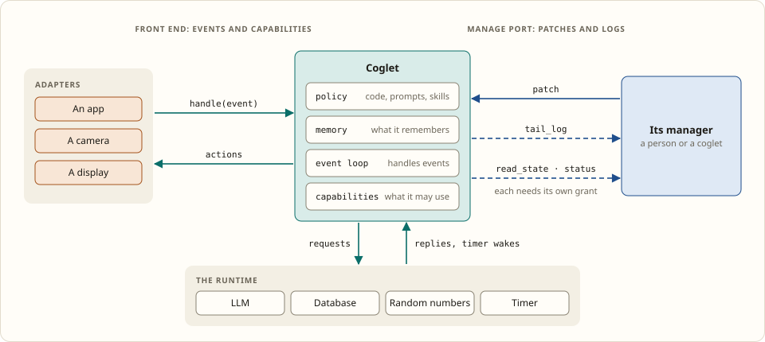

# Cogent


A **cogent** is one logical agent. It has an **identity**, a **name** and an
**owner**, and it runs as a **collection of coglets** spread over many runtimes.
Each runtime exposes **unforged repositories**; each coglet is a **user** in one,
and **adapters** are mounted into it like devices. Every runtime runs a **hub**,
a smart **router** plus an **optimizer** that improves it, and the hubs peer to
hold the cogent together. There is no centre: memory, factories and databases
are coglets just like Face or the Blender coglet. The cogent is **present** on a
few of them at a time, the ones it is paying attention to, and the rest run on
their own. This is the design, split into pieces so they can be built in
parallel.

Pages: [Coglets and runtime](coglets-and-runtime.md) ·
[App integration](app-integration.md) ·
[The Softmax app](softmax-app.md) ·
[Cognitive architecture](cognitive-architecture.md) ·
[Coglets on unforged](unforged.md) ·
[Staged integration](unforged-staging.md) ·
[Secrets and adapters](secrets.md) ·
[LLMs on unforged](llms.md)


*A cogent: hubs on many runtimes, peered with each other, and coglets attached
to each hub. On each device, a hub, Face and the coglets for that device's
apps; on a Softmax-hosted runtime, a hub with the factory, memory and a
database. Apps have adapters, and coglets use the apps through them. The
outlined coglets are where the cogent is present right now.*

## Adapter

An adapter is an interface that an app exposes: whatever **observations**,
**events** and **actions** the app's developer chooses to offer.

**What it does.** It is the boundary between an app and a cogent. It **reports**
what happens in the app, **carries out** what coglets ask for, and **decides
what is allowed**. Without it an agent would have unscoped control of the app. A
developer usually builds it as a mod, an add-on or an extension, and an app can
have more than one: for example one for its UI and one for a player.

**Example.** One app can offer several adapters, each a different scope of
control. Minecraft might have three:

| Adapter | What it lets a coglet do | What it lets a coglet see |
|---|---|---|
| Avatar | Control one player character, with only the moves a player can legally make. | What that character observes. |
| Builder | Create arbitrary objects in the world. | Everything that is going on in the world. |
| UI | Make panels and other controls, and modify the user interface. | What the user does with them. |


*Coglets and adapters are many-to-many. The player and the face both use the UI
and avatar adapters; the builder uses the avatar and builder adapters; the
avatar adapter serves all three.*

The relationship runs both ways: a coglet can be granted several adapters, and
an adapter can be granted to several coglets.

A coglet granted only the avatar adapter can play the game and nothing more. A
coglet granted the builder adapter can reshape the world. The developer decides
which adapters exist, and each one is granted separately.

**Interfaces.**

```idl
Adapter
  capabilities()
      List the events, observations and actions it offers.
  grants()
      Say which coglet may use which of them. Only the adapter can grant.
  observe(Read) -> ReadReply
      Return a snapshot of something in the app.
  act(Act) -> Accept
      Do something in the app, or refuse. As narrow as "move the player" or as broad as
      "run this script", whichever the developer chose to offer.
```

**Messages.**

| It generates | It processes |
|---|---|
| Events: things that happened in the app | Actions from coglets |
| An accept or a refusal for each action, then one outcome | Read requests |
| Its capability list and its grants | |
| A notice when its off-switch is pulled | |

**Mounted like a device.** Inside a runtime, an adapter is mounted into the
repository under `/net/<adapter>/`. A coglet granted it sees its catalog there:
listing reads the tools it offers, writing a call stages an action, and the
outcome comes back in the next input. Secrets stay in the adapter. Detail:
[Secrets and adapters](secrets.md#adapters-as-mounts).

Detail: [App integration](app-integration.md#adapter).

## Coglet

A coglet is a **policy**, a **memory**, an **event loop** and **capabilities**.
It handles events, and it has a **manage port** for receiving patches and
streaming logs to its manager.

**What it does.** It does one job: being the face, driving one app, running the
factory. It waits for events, and for each one decides what to do using its
policy and its memory. It is a generalization of a game policy script: a
tree of files where a policy is one file, and `handle(event)` for many kinds of
event where a policy has only `step()`.

The policy is whatever decides what the coglet does: **symbolic code**, **LLM
prompts** and **skills**, or any mix of them. A patch can change any of it. The code part can be
in any language its runtime supports.

A coglet can use several adapters at once, and several coglets can use the same
one. On a robot, both the face and the controller use the camera.

**A user in a repository.** A coglet lives in an unforged repository as a
**user**: it has its own key and signs what it changes, its own namespace of
refs (`refs/users/<coglet>/…`), and its own grants. It sees its own tree as its
filesystem, `/code`, `/data` and `/logs`, and nothing of other users' trees
unless granted. Each step it takes is a commit; each patch it receives is a
merge. **Skills arrive by patch**: a new skill is a commit on the coglet's
`policy` ref, merged in between steps. Detail:
[Coglets on unforged](unforged.md).



*The coglet in the middle. Apps and hardware, reached through adapters, on the
left. What the runtime provides below. Its manager on the right, with patches
coming in and logs going out.*

**Capabilities.** A capability is anything a coglet is allowed to use. Some come
from **adapters** and some from the **runtime** itself. A coglet names the ones it
wants when it registers, and can use only those.

**Interfaces.**

```idl
Coglet
  -- front end

  register(Manifest)
      Declare the capabilities it wants: events to subscribe to, actions it needs.
  handle(event)
      Process an event, or a small batch of them.

  -- manage port, to its manager

  patch(change)
      Receive a patch to its policy: code, prompts or skills. This is how it learns.
  tail_log()
      Stream its log to its manager.
```

**Messages.**

| It generates | It processes |
|---|---|
| Actions on an adapter | Events from the adapters it subscribed to |
| Messages to other coglets | Messages from other coglets |
| Requests to a model | Replies from a model |
| Timers, and log lines for its manager | Timer wakes, the outcome of each action it asked for, and patches from its manager |

Detail: [Anatomy of a coglet](coglets-and-runtime.md#anatomy-of-a-coglet).

### Kinds of coglet

Coglets come in **kinds**, and each kind has several implementations: several
routers, several databases, several Faces. A kind fixes the messages a coglet
provides and calls; the implementation is its policy, and a patch can swap one
for another.

| Kind | What it does |
|---|---|
| [Router](#router) | Carries messages and patches; the cogent's attention. |
| [Optimizer](cognitive-architecture.md#optimizercoglet) | Improves its hub's router, and other coglets it is granted. |
| [Face](#face) | Watches and listens to the user, and delegates. |
| App coglet | Drives one or more apps through their adapters. |
| Controller | Drives hardware that moves, such as wheels or a hand. |
| [Factory](cognitive-architecture.md#factorycoglet) | Takes tickets, produces patches and other artifacts. |
| [Memory](cognitive-architecture.md#memorycoglet) | Holds what the cogent knows, for other coglets to read and add to. |
| Database | Structured data coglets share, such as tickets and records. |

## Runtime

A runtime supports running a set of coglets. It exposes one or more
**unforged repositories**, runs coglets in them as users, and manages
**routing events**, **executing the coglet code**, and **providing and managing
capabilities**.

**What it does.** It loads each coglet and runs its event loop. It **delivers events** to the coglets that subscribed to them, and **carries
what a coglet asks for** to the right place: an adapter, another coglet, a
model. It also serves each
coglet's manage port, so the coglet's own code never has to. It mounts each
adapter it connects to into its repositories, and it can be connected to
several adapters at once.

**Any app can host a runtime**, by embedding it or by running `cogletd` beside
it: a game, Blender, a browser, a phone app, or the [Softmax app](softmax-app.md),
which is one host among many. A runtime can also run on a server or on Softmax
infrastructure.


*Two runtimes whose routers peer. Each exposes an unforged repository; every
coglet in it is a user, and the adapters it connects to are mounted into it. Each coglet has the colour of the engine it runs on, and
the arrows down show which of the runtime's capabilities it uses.*

**Execution engines.** A runtime may have several execution engines, one for
each language a policy's code can be written in: for example BASIC, WASM,
JavaScript, Java and Python. Engines are pluggable, so two runtimes need not
offer the same set. A coglet's policy picks the engine; everything else about
the coglet stays the same.

An LLM is not an engine. It is a capability: a policy that relies on prompts
and skills runs on one of these engines and calls the LLM capability.

**Capabilities.** A runtime also provides capabilities of its own to the
coglets it runs: for example a database, a key-value store, a random number
generator, an LLM and a GPU. Like engines, these can differ from one runtime to the
next.

**Routing.** Every message goes through the runtime's own router, part of its
[hub](#hub). Between two coglets on the same runtime that is an in-process hop;
to a coglet on another runtime, the router passes it to that runtime's router
over the network.
Either way the coglets see the same thing.

**Interfaces.**

```idl
Runtime
  repositories() -> [Repo]
      The unforged repositories it exposes.
  run(coglet, Repo)
      Add a coglet as a user of the repository and run its event loop.
  stop(coglet)
  connect(adapter)
      Open a link to an adapter, learn its capabilities and grants, and mount it
      under /net/<adapter>/.
  join(cogent)
      Start this runtime's hub and peer it with the cogent's other hubs.
```

**Messages.**

| It generates | It processes |
|---|---|
| Timer wakes | Everything passing between its coglets and its adapters |
| A notice to a coglet when something it asked for was refused | Messages between two of its own coglets, which it hands to its hub's router, in process |
| Health reports to its hub's router | From the router: install, start, stop, patch and read requests, and messages for its coglets |

A runtime writes almost nothing of its own. Its work is carrying other parts'
messages to the right place, in order.

Detail: [Coglets and runtime](coglets-and-runtime.md#runtime).

**Rules.**

- Coglets never connect to each other directly; the runtime and its router carry
  every message.
- Nothing returns a value in place; a result arrives later as a new event.
- An adapter has the final say over its own app or hardware.
- Latency-sensitive work, such as voice, stays on the local runtime.

## Router

The router is a coglet that carries **messages and patches** between coglets,
within its runtime and to the routers of other hubs. It is also **smart**: it is
the cogent's **fast loop** and its **attention**. It answers what present
coglets send, decides what to forward and where, checks memory, files tickets
with a factory, applies the patches that come back, and sets presence.

There are several router implementations, from a plain table of rules on a
small device to a model-driven one on a hosted runtime; they provide the same
messages, so one can replace another by patch.

```idl
Router
  -- carries
  deliver(Message)
      To a coglet on this runtime, or to the router of the hub that has it.
  install(coglet, Runtime), patch(coglet, Patch)
      Through the target coglet's manage port.

  -- thinks: the fast loop
  on feature.request, intent.report needs_help, presence.request, presence.check_in
      Answer, forward, or file a ticket; apply the patch from its result.

  -- attends: presence (ADR-0036)
  presence.get, presence.set, presence.changed
```

Detail: [RouterCoglet](cognitive-architecture.md#routercoglet).

## Hub

A **hub** is a **router** plus an **optimizer** that improves it. The optimizer
watches how the router routes and decides, files tickets for improvements, and
patches the router's policy (and, where it is granted, its own and other
coglets').

Every runtime that joins a cogent runs a hub, and the hubs **peer**: their
routers know each other and carry messages between their runtimes. A cogent is
a set of peered hubs and the coglets attached to them. A hub on a
Softmax-hosted runtime is one hub among several, not the centre.

**On a device**, the runtime runs a hub, a **Face**, and the coglets that manage
that device's adapters: an app coglet for Blender, a controller for a robot's
wheels.

Detail: [ADR-0040](../adr/0040-hubs-and-coglets-on-unforged.md).

## Face

Face is the coglet the user deals with. It **listens to gestures and voice** and
**records the screen**, with the user's permission and within its adapter's
grants, so it knows what the user is doing and pointing at.

It can **drive an app a little**, for small and obvious things, but mostly it
**asks the right coglet** to act: it sends a `UserIntent` to the app coglet for
the app in question, through the router, and tells the user what happened.

Detail: [FaceCoglet](cognitive-architecture.md#facecoglet).

## Cogent

A cogent is one logical agent. It has an **identity**, a **name** and an
**owner**. It runs as a **collection of coglets**.

It has no centre. It is a set of **hubs**, one on every runtime it uses,
peered with each other, and the coglets attached to them:

- on each **device**: a hub, **Face**, and **app coglets** and **controllers**
  for that device's apps and hardware. One coglet can drive several apps, and
  several coglets can share one app.
- on a **Softmax-hosted runtime**, typically: a hub, **factories**, **memory**
  and **databases**, where there is compute and storage.

Not everything it connects to is a device the user owns. Games hosted in the
Softmax Universe, such as Paintbot, GOTA and PudgeWars, have adapters too, and
the cogent runs coglets for them in the same way.

All of these are equally part of the cogent. A coglet runs where it makes
sense: on the device, where the microphone or the app is and latency matters,
or on a hosted runtime, where there is compute and storage. Any of them can move
to another runtime, including the user's own machine.

### Presence

The cogent is **present** on a few coglets at a time. Presence is attention:
what a present coglet sends to the cogent reaches a router as it happens,
and the cogent answers within that coglet's latency budget. Usually that is
Face on the device the user is using and the app coglet for the app they are
working in.

Every other coglet runs **autonomously**, on its own policy and memory. What it
sends the cogent on its own initiative is held and delivered in a **check-in**
every few minutes; answers to the cogent's own calls are never held. The cogent
manages it now and then through its manage port: reading its status and logs,
and patching it. A coglet that needs the cogent sooner asks for attention, and
the router decides.

Presence changes no grant and starts or stops nothing. It only says where the
cogent is looking.

```idl
Router
  presence.get() -> Presence
  presence.set(PresenceChange) -> Presence
      Granted by default to the attending router and to the owner.
  presence.request(PresenceRequest)
      Any coglet, usually an absent one, asks for attention.
  presence.changed(Presence)
      Tells subscribers, and every coglet that entered or left presence.
  presence.check_in(CheckIn)
      Delivers what an absent coglet held for the cogent, at the cadence the router set.
```

Detail and rules: [ADR-0036](../adr/0036-distributed-cogent-and-presence.md);
the attention is a router since [ADR-0040](../adr/0040-hubs-and-coglets-on-unforged.md).

## A request, end to end

"Make me a torus", said by a user who has only Blender installed, when the
Blender coglet does not yet know how.


*The first two steps are the whole flow when the app coglet already knows
what to do. The rest is how it learns. Face and the Blender coglet are present;
the router, memory and factory are wherever they run. Who files the ticket
is not settled; see the note below.*

1. The user holds push-to-talk and speaks. Face gets the voice event, the
   transcript and what is on screen, decides the request is for Blender (or
   asks), sends the Blender coglet a `UserIntent` and says "On it."
2. The Blender coglet looks in its skill library. If it knows how, it acts
   through the Blender adapter and reports `done`.
3. If it does not, it reports `needs_help`. Face tells the user, asks for an
   explanation or a demonstration, and captures the answer and its context.
4. Face sends a `FeatureRequest` to its hub's router.
5. The router checks memory for whether the cogent already knows how, finds
   nothing, and a ticket is filed with the factory, which works on it on its
   own and reports back.
6. The factory writes the new skill, tests it against a local Blender
   simulator, and returns the patch in its ticket result.
7. The router applies the patch to the Blender coglet: a merge into its
   `policy` ref, which is how skills arrive. Face is told, and tells the user it
   can now draw tori.

**Not settled: who files the ticket.** It could be the router, acting on the
request as it arrives, or its hub's optimizer, acting on what it sees in the
router's interactions. The same question applies to who applies the patch. The
messages are the same either way (`ticket.submit` to the factory, `patch` on
the manage port), so the other pieces can be built before this is decided.
