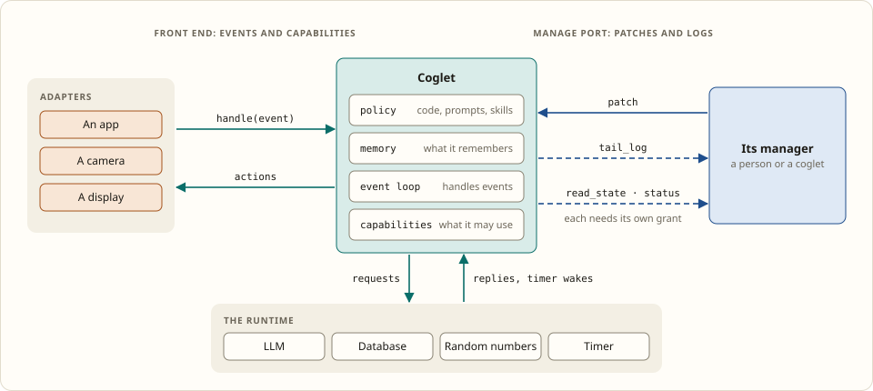
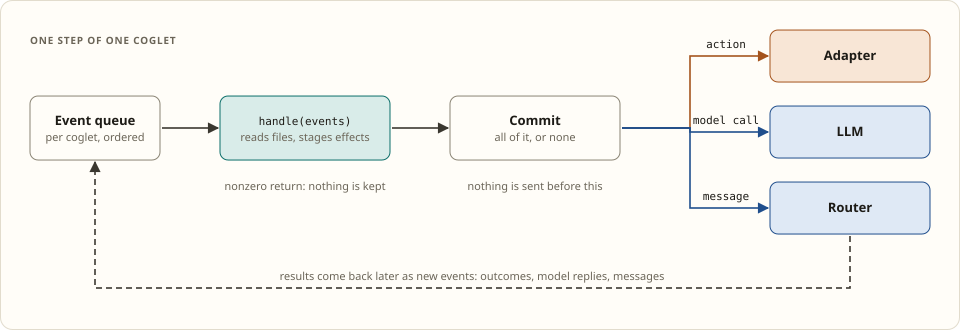
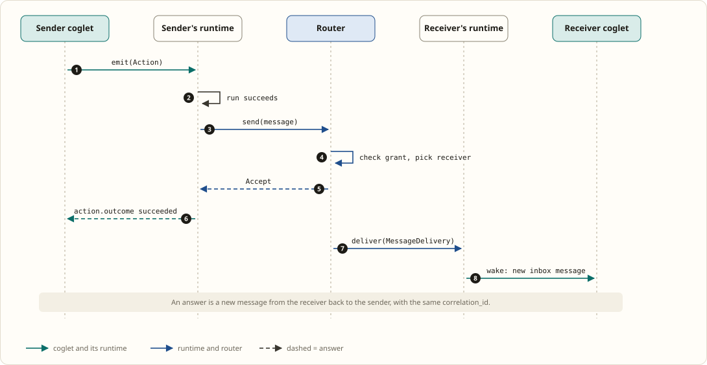

# Coglets and runtime

What a coglet is made of, what a runtime does for it, and the types they share.
Part of the [cogent design](README.md).

## Anatomy of a coglet

A coglet is a **policy**, a **memory**, an **event loop** and **capabilities**.
It handles events, and it has a **back channel** for receiving patches and
streaming logs to its manager.

The policy is whatever decides what the coglet does: **symbolic code**, **LLM
prompts** and **skills**, or any mix of them. A patch can change any of it.



*The coglet in the centre. Apps and hardware, reached through adapters, on the
left. What the runtime provides below. Its manager on the right, with patches
coming in and logs going out.*

```idl
Coglet
  -- front end: how it does its job

  register(Manifest)
      Declare the capabilities it wants: which events to subscribe to, which actions it
      needs, and which resources it must own alone. It runs only once all of them are
      granted.
  handle(event)
      Process an event. It may read and write its memory and ask for things: an action on an
      adapter, a message to another coglet, a model call, a timer, a log line.

  -- back channel: how its manager changes and watches it

  patch(change)
      Receive a patch to its policy: code, prompts or skills. This is how a coglet learns.
  tail_log()
      Stream its log to its manager as it is written.
  read_state()
      Let its manager read its memory.
  status()
      Whether it is running, paused or faulted.
  pause(), step()
      Stop it, and run it one event at a time, for debugging.
```

| | Front end | Back channel |
|---|---|---|
| Who uses it | The runtime, on behalf of adapters and other coglets | Its manager: a person, or a cogent coglet such as the fast loop or the optimizer |
| What it is for | Doing the work | Changing and inspecting the coglet |
| Needs | The capabilities named in the manifest | A separate grant for each operation; reads are off unless granted |
| The coglet's own code | Is what runs | Does nothing; the runtime serves these between events |

A coglet is stored as four things: its policy, its memory, its logs, and a
manifest naming the capabilities it wants.

A capability is anything a coglet is allowed to use. Some come
from adapters and some from the runtime itself. A coglet names the ones it
wants when it registers, and can use only those.

| Capability | What it gives the coglet | Provided by |
|---|---|---|
| An app, for example `blender.act` | See and act in that app. | The app's adapter |
| A camera, a microphone, a display | Use that piece of hardware. | The device's adapter |
| LLM | Ask a model a question. The answer arrives as a later event. | The runtime |
| Database | Keep structured memory and query it. | The runtime |
| Random number generator | Random numbers, seeded so a run can be replayed exactly. | The runtime |
| Timer | Be woken at a later time. | The runtime |

The sections below give the detail of each side.

## Front end

The front end is how a coglet does its job: it registers the capabilities it
wants, then handles events.

### Registering: the manifest

```idl
Manifest
  # What a coglet wants. It runs only once all of it is granted.
  id          CogletId
  subscribes  [OpName]   Events it wants to be woken by.
  needs       [OpName]   Everything it may ask for: adapter actions, messages to other coglets,
                         and runtime capabilities such as the LLM.
  owns        [OpName]   Things it must have to itself, for example the speaker.
  budgets     Budgets

Budgets
  # Limits the runtime enforces on every event the coglet handles.
  compute     u64        How much work one event may take.
  memory      u64        How much memory it may use.
  time_us     u64        How long one event may run.
  max_events  u64        The most events it will take at once.
```

### Handling events

```idl
Handler
  handle(events, step, time, seed)
      Run once. `events` is one or more Events, oldest first. `step` counts runs from zero.
      `time` is the runtime's clock. `seed` is the only source of randomness. If it succeeds,
      everything it did is kept; if it fails, none of it is.
```

Handling an event is all-or-nothing. The coglet reads and writes its memory and
asks for things as it goes, and nothing leaves the runtime until the whole run
has succeeded.



*One run. What the coglet asked for is sent only after the run succeeds, and
every result comes back later as a new event.*

### What wakes a coglet

| Event | Carries | Meaning |
|---|---|---|
| An adapter event it subscribed to | What the adapter defines | Something happened in an app or on the device. |
| `runtime.timer` | `{id, at}` | A timer it set came due. |
| `runtime.inbox` | `{index, id}` | Something arrived in its inbox. |
| `runtime.step` | `{}` | Its manager stepped it once while paused. |

### The inbox

Anything addressed to one coglet arrives in its inbox: a message from another
coglet, the reply to a model call, or the outcome of something it asked for.

```idl
InboxMessage
  index   u64       Position in the inbox, from zero. The coglet keeps its own place.
  id      Id        The same id never appears twice.
  sender  SourceId  Who it is from. Checked by the runtime, never just claimed.
  event   Event     The content.
```

| Inbox event | Carries | Meaning |
|---|---|---|
| A message name, for example `intent.request` | `MessageDelivery` | Another coglet sent this. |
| `llm.reply` | `LlmReply` | The answer to a model call. |
| `action.outcome` | `Outcome` | Something it asked for has finished. |
| `runtime.action_rejected` | `Accept` with `accepted` false | Something it asked for was refused. |
| `message.undelivered` | `MessageUndelivered` | A message it sent could not be delivered. |

### Asking for things

What a coglet can ask for while handling an event. Each request is held until
the run succeeds, so the answer never comes back in the same run.

```idl
Requests
  emit(Action) -> Staged
      Ask an adapter to do something, or send a message to another coglet. Which one is
      decided by the action's `capability`.
  llm(LlmRequest) -> Staged
      Ask a model. The reply arrives later in the inbox.
  timer(TimerRequest) -> Staged
      Be woken once at a later time.
  log(LogEntry) -> Staged
      Write one log line.
  db(DbRequest) -> Staged
      Query or update the coglet's database. The request shape is not written down yet.

Staged
  STAGED              0
  INVALID_ARGUMENT    1
  PERMISSION_DENIED   2  The capability was not granted.
  RESOURCE_EXHAUSTED  3
  CONFLICT            4  An id was reused.

TimerRequest
  id  Id
  at  u64  When, on the runtime's clock. A timer cannot be changed once set.

LlmRequest
  id              Id
  correlation_id  Id
  model           str         Which kind of model to use, not a provider's model name.
  input           ProfileMap

LlmReply
  request_id  Id
  status      "succeeded" | "failed"
  output      ProfileMap?
  error       Error?

LogEntry
  level    "debug" | "info" | "warn" | "error"
  message  str
  fields   ProfileMap
```

## Back channel

The back channel is how a coglet's manager changes it and watches it. The
manager can be a person, or another coglet such as the fast loop or the
optimizer applying a patch.

The coglet's own policy does nothing to serve the back channel. The runtime
does it, between events, and keeps a record of every change. Each operation
needs its own grant, and reading is off unless granted.

```idl
BackChannel
  patch(coglet, Patch) -> ChangeReceipt
      Replace part or all of the coglet's policy. Takes effect before the next event.
  tail_log(coglet) -> stream of LogEntry
      Follow the coglet's log as it is written.
  read_state(coglet, ReadState) -> StateChunk
      Read part of the coglet's memory or its log.
  status(coglet) -> CogletStatus
  pause(coglet) -> ChangeReceipt
  step(coglet) -> ChangeReceipt
      Handle exactly one event while paused.

Patch
  # A change to a coglet's policy: code, prompts, skills, or any mix.
  base       str?  The policy revision this was made from. The patch is refused if the
                   coglet has moved on.
  revision   str   The new revision.
  signature  str   Proof of who made it.

ReadState
  path    str  What to read: a place in the coglet's memory or log.
  offset  u64
  limit   int 1..65536

StateChunk
  text         str
  next_offset  u64
  eof          bool

CogletStatus
  state     "stopped" | "running" | "paused" | "faulted"
  revision  str?   The policy revision it is running.
  pending   int    Events waiting to be handled.
  error     Error?

ChangeReceipt
  # The answer to anything that changes a coglet.
  id     Id
  state  "queued" | "applied" | "cancelled" | "failed"
  error  Error?

OnBehalfOf
  # Sent with every back-channel request.
  manager  SourceId  Who is asking.
  ticket   Id?       The factory ticket that authorizes it, if any.
```

## Runtime

A runtime supports running a set of coglets. It manages routing events,
executing the coglet code, and providing and managing capabilities.

```idl
Runtime
  run(coglet)
      Load a coglet and run its event loop.
  stop(coglet)
  connect(adapter)
      Open a link to an adapter and learn its capabilities and grants.
  join(router)
      Make itself known to a cogent, so the cogent can run coglets here.
```

A runtime can be its own process next to an app, or be built into one. It can
be connected to several adapters at once, and it can have several execution
engines, one per language a policy's code is written in.

### Where a request goes

After a run succeeds, the runtime sends each thing the coglet asked for to
whoever provides it.

| The coglet asked for | The runtime sends it to | The coglet later sees |
|---|---|---|
| An action on an adapter | That adapter | The adapter's outcome |
| A message to a coglet in the same runtime | That coglet's inbox, directly | The outcome, as soon as it is delivered |
| A message to a coglet in another runtime | The router | The outcome, as soon as the router accepts it |
| A model call | The LLM capability | An `llm.reply` |
| A timer, a log line, a database query | Itself | A timer wake; nothing; the query's rows |

A refusal from any of them becomes a `runtime.action_rejected` in the inbox.

### Messages between coglets

A message is an `Action` whose `capability` is a message name such as
`intent.request`. The coglet does not need to know where the other coglet runs.

- **Same runtime.** The runtime checks the grant and puts the message straight
  into the other coglet's inbox.
- **Different runtimes.** The runtime hands the message to the router, which
  checks the grant and delivers it to the other runtime.



*Between runtimes. The sender gets its outcome as soon as the router accepts.
Delivery to the receiver is a separate step.*

Either way:

1. The sender's outcome means the message was accepted for delivery, not that
   the receiver has acted on it.
2. The receiver finds a `MessageDelivery` in its inbox.
3. An answer is a new message back to the sender, carrying the same
   `correlation_id`.

A message reaches its receiver in one of two ways:

| Route | Who picks the receiver |
|---|---|
| `bound` | Configuration: for this sender and this message, there is one receiver. |
| `addressed` | The message itself, in its `to` field. |

```idl
MessageDelivery
  # What the receiver finds in its inbox. The inbox event's name is the message name.
  caller  CogletId    Who sent it. Checked, never just claimed.
  id      Id          The sender's action id. `(caller, id)` identifies the message for good.
  args    ProfileMap  What the sender sent.

MessageUndelivered
  # Sent back to the sender if an accepted message could not be delivered after all.
  id     Id
  error  Error

MessageGrants
  # Which messages a coglet may send.
  epoch     u64       Rises with every replacement.
  messages  [OpName]
  expires   u64
```

### Runtime and router

What passes between a runtime and the cogent's router.

```idl
RuntimeToRouter
  join(JoinParams) -> JoinResult
      Join a cogent with a one-time invite.
  send(coglet, Action) -> Accept
      Hand over a message for a coglet in another runtime.
  relay_events(coglet, [Event])
      Pass adapter events upward for coglets that subscribed from elsewhere.
  report_health(Health)
      Say how the runtime and each of its coglets are doing.

RouterToRuntime
  install(coglet, Patch) -> ChangeReceipt
      Put a new coglet on this runtime, with its first policy.
  start(coglet) -> ChangeReceipt
  stop(coglet) -> ChangeReceipt
  deliver(coglet, InboxMessage) -> ChangeReceipt
      Put a message, or a model's reply, into a coglet's inbox.
  act(coglet, Action) -> Accept
      Ask the runtime to carry out one action on a coglet's behalf.
  set_message_grants(coglet, MessageGrants) -> ChangeReceipt
  -- plus every BackChannel operation, each with OnBehalfOf

JoinParams
  versions  [SpecVersion]
  invite    str?           Single use. Absent once the runtime has joined.

JoinResult
  version  SpecVersion
  runtime  NodeId
  router   RouterId

Health
  runtime          NodeId
  uptime_ms        u64
  waiting          u64             Events waiting across all coglets.
  available_bytes  u64
  coglets          [CogletHealth]

CogletHealth
  coglet  CogletId
  status  CogletStatus
```

## Shared types

### Scalars

```idl
u64 = int 0..2^64-1
  # Every counter, clock and size. There are no floats anywhere on the wire.

Id = str /^[0-9a-f]{32}$/
  # A 128-bit id in lowercase hex. Used for actions, correlations, utterances, streams, tickets
  # and every other opaque identifier.

NodeId = str /^[0-9a-f]{64}$/
  # A public key in lowercase hex. Identifies one runtime.

CogletId = str /^coglet:[0-9a-f]{64}$/

AdapterId = str /^adapter:[0-9a-f]{64}$/

RouterId = str /^router:[0-9a-f]{64}$/

SourceId = CogletId | AdapterId | RouterId
  # Who produced an event. Always authenticated, never just claimed.

OpName = str /^[a-z][a-z0-9_]{0,31}\.[a-z][a-z0-9_]{0,31}$/
  # An operation or resource name such as `speech.end` or `audio.mic`. The spec calls this a
  # capability-name.

ProfileValue = (int | str | bool | [ProfileValue] | ProfileMap)?

ProfileMap = {str: ProfileValue}
  # Free-form structured data. Integers only, no floats and no byte strings.
```

### `Event`

```idl
Event
  # Something that happened. The only thing a coglet is ever woken with.
  source          SourceId    The adapter, coglet or router that produced it.
  kind            OpName      What happened, for example `speech.end` or `runtime.timer`.
  seq             u64         Per-source sequence number. Increases on every delivery.
  logical_time    u64         The source's own clock in microseconds. Never compared across
                              sources.
  payload         ProfileMap  The typed body. Its shape is fixed by `kind`.
  correlation_id  Id          Ties this event to the request or conversation it belongs to.
```

### `Action`

```idl
Action
  # A request for an effect. A coglet stages one with `emit`.
  id              Id          Unique for the life of the coglet. The key for deduplication.
  coglet          CogletId    The coglet asking. Must match the running coglet's identity.
  capability      OpName      The operation, for example `speech.speak_chunk` or `intent.request`.
  args            ProfileMap  The typed arguments. Their shape is fixed by `capability`.
  deadline        u64         Runtime-clock microseconds after which the action must not start.
  correlation_id  Id          Copied onto the accept, the outcome and any reply.
```

### `Accept`

```idl
Accept
  # The provider's admission decision. Not completion.
  id              Id
  correlation_id  Id
  accepted        bool    True means the provider took the work and owes exactly one Outcome.
  error           Error?  Present only when `accepted` is false. A rejected action has no
                          outcome.
```

### `Outcome`

```idl
Outcome
  # The one terminal result of an accepted action. Reaches the coglet as an inbox event of kind
  # `action.outcome`.
  id              Id
  correlation_id  Id
  status          "succeeded" | "failed" | "cancelled" | "expired"
  result          ProfileMap?                     Present only when succeeded. Empty for every
                                                  operation defined today.
  error           Error?                          Present for failed, cancelled and expired.
```

### `Error`

```idl
ErrorCode = "invalid_argument" | "unsupported_version" | "unauthenticated" | "permission_denied" | "not_found" | "conflict" | "resource_exhausted" | "deadline_exceeded" | "cancelled" | "unavailable" | "internal"

Error
  code       ErrorCode
  message    str
  retryable  bool         True means the identical request may be sent again.
  details    ProfileMap?
```

### Versions

```idl
SpecVersion = str /^(0|[1-9][0-9]{0,3})\.(0|[1-9][0-9]{0,3})$/

VersionOffer
  # Sent by whoever opens a session.
  versions  [SpecVersion] at least 1 items

VersionSelection
  # The answer: the one version both sides will speak.
  version  SpecVersion
```
