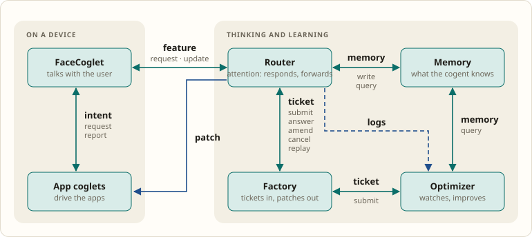
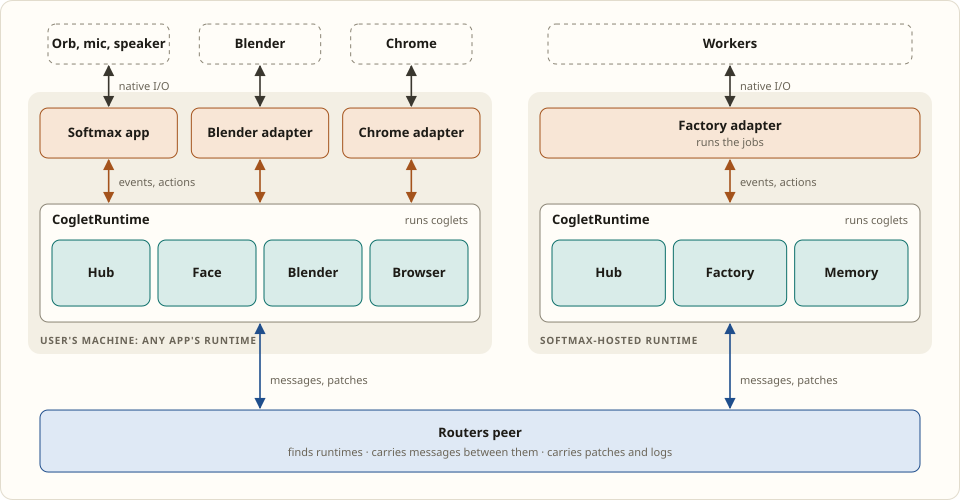

# Cogent cognitive architecture

Part of the [cogent design](README.md): the coglets that do the cogent's
thinking and learning, and how they are wired. None of them is a centre. Every
runtime runs a **hub**, a router and an optimizer, and every other coglet
reaches the rest through its hub's router
([ADR-0036](../adr/0036-distributed-cogent-and-presence.md),
[ADR-0039](../adr/0039-hubs-and-coglets-on-unforged.md)).

## Who talks to whom



*Teal arrows are families of messages between two coglets, with the calls
listed beside them. Blue arrows are the manage port, which is separate: a
patch going in to a coglet, and logs streaming out of one. The full list is in
the table below.*

| From | Message | Payload | To | Carried by |
|---|---|---|---|---|
| Face | `intent.request` | `UserIntent` | an app coglet | their runtime |
| app coglet | `intent.report` | `IntentReport` | Face | their runtime |
| Face | `feature.request` | `FeatureRequest` | router | their runtime |
| router | `feature.update` | `FeatureUpdate` | Face | their runtime |
| router | `ticket.submit`, `.answer`, `.amend`, `.cancel`, `.replay` | ticket requests | factory | the routers of their hubs |
| optimizer | `ticket.submit`, `.replay` | ticket requests | factory | the routers of their hubs |
| factory | `ticket.receipt`, `.update`, `.result` | ticket reports | the submitter | the routers of their hubs |
| router, optimizer | `patch` | a `Candidate` | any coglet | the manage port, through the router |
| optimizer | `tail_log`, `read_state` | | its hub's router | the manage port |
| router, optimizer | `memory.write`, `memory.query` | `MemoryWrite`, `MemoryQuery` | memory | the routers of their hubs |
| memory | `memory.result` | `MemoryResult` | the asker | the routers of their hubs |
| attending router, owner | `presence.set` | `PresenceChange` | router | the router |
| any coglet, usually an absent one | `presence.request` | `PresenceRequest` | attending router | the router |
| router | `presence.check_in` | `CheckIn` | attending router | the router |

## Where everything runs



*One possible placement. On the user's machine, a runtime hosted by any app (the
Softmax app here) runs a hub, Face and the coglets for its apps, next to their
adapters. A Softmax-hosted runtime runs another hub, the factory and memory.
Neither is the centre: the two hubs' routers peer, and any coglet could run on
either runtime.*

## FaceCoglet

The coglet the user deals with. It listens to gestures and voice, records the
screen (with the user's permission), and talks to the user itself. It can drive
an app a little, for small and obvious things, but mostly it asks the right
coglet to act. On a Mac with the Softmax app it subscribes to that app's
push-to-talk and voice events and controls the floating orb; other host apps
offer their own adapters. Voice is transcribed on the user's machine or sent from there
straight to the speech provider; it does not pass through Softmax infrastructure.

### `FaceCoglet`

```idl
FaceCoglet
  subscribes  speech.start, speech.partial, speech.end, speech.position, speech.barge_in,
              speech.tool_call
  needs       speech.speak_chunk, speech.stop, speech.backchannel, speech.session_open,
              speech.session_close, speech.tool_result, expression.set_expression,
              llm.complete, intent.request, feature.request
  owns        audio.mic, audio.speaker, display.face

  on        speech.end          SpeechEnd
            Decide which app the request is for, or ask. Send that app's coglet a UserIntent
            and acknowledge aloud.
  on        speech.barge_in     SpeechBargeIn
            The adapter already stopped the audio. Record how far playback got.
  provides  intent.report       IntentReport    addressed
            Tell the user the result. On `needs_help`, ask the user to explain or demonstrate,
            then send a FeatureRequest.
  provides  feature.update      FeatureUpdate   addressed
            Tell the user when a new ability has arrived.
  calls     intent.request      UserIntent      addressed
  calls     feature.request     FeatureRequest  bound
```

### Face types

```idl
UserIntent
  # Face to an app coglet: the user wants this done.
  to        CogletId            The app coglet the request is for.
  intent    Id
  text      str 1..4096 chars   What the user asked, for example "make me a torus".
  context   ProfileMap?         Anything Face already knows that helps.

IntentReport
  # App coglet to Face. Sent on each change of state.
  to        CogletId
  intent    Id
  state     "working" | "done" | "failed" | "needs_help"
  summary   str                 One or two plain sentences Face can say aloud.
  question  str?                Present with `needs_help`: what the coglet does not know.

FeatureRequest
  # Face to the router: an app coglet could not do something the user wants.
  request      Id
  coglet       CogletId         The app coglet that needs the new ability.
  text         str              What the user asked for.
  guidance     str              The user's explanation, in their words.
  context      [ContextRef]     References to the transcript and to what the user did. Never
                                raw content.

FeatureUpdate
  # Router to Face.
  to        CogletId
  request   Id
  state     "received" | "building" | "shipped" | "failed"
  summary   str                 One or two plain sentences Face can say aloud.
```

> **Not settled:** whether the router or the optimizer files tickets with
> the factory and applies the patches. Both are written below as able to; only
> one may end up doing it.

## FactoryCoglet

Takes tickets and produces artifacts: a new skill, a changed coglet. It tests
its work, for example against a local simulator of the target app, before it
reports. It does not apply its own output; it returns a patch and the router
or the optimizer applies it. The scheduler that does the work is reached
through a factory adapter, so it can be replaced.

### `FactoryCoglet`

```idl
FactoryCoglet
  subscribes  worker.progress, worker.question, worker.done
  needs       worker.dispatch, worker.cancel, ticket.receipt, ticket.update, ticket.result
  owns        (nothing)

  provides  ticket.submit       TicketSubmit    bound
            Admit a new ticket, answer with `ticket.receipt`, then dispatch.
  provides  ticket.answer       TicketAnswer    bound
  provides  ticket.amend        TicketAmend     bound
  provides  ticket.cancel       TicketCancel    bound
  provides  ticket.replay       TicketReplay    bound
  on        worker.progress     WorkerProgress
  on        worker.question     WorkerQuestion
  on        worker.done         WorkerDone
  calls     ticket.receipt      TicketReceipt   addressed
  calls     ticket.update       TicketUpdate    addressed
  calls     ticket.result       TicketResult    addressed
```

### `Ticket`

From `spec/tickets.md`. Contains no provider, model or board fields.

```idl
Ticket
  target        TicketTarget
  goal          TicketGoal
  context       [ContextRef]
  capabilities  TicketCapabilities
  gates         TicketGates
  budget        TicketBudget

TicketTarget
  coglet  CogletId  The coglet to change.
  repo    str
  base    str       The full commit the change starts from.

TicketGoal
  description  str                     The request in plain words.
  acceptance   [str] at least 1 items  Testable criteria, written by whoever files the ticket.

ContextRef
  kind  "world_snapshot" | "transcript" | "trace" | "document"
  ref   str                             An immutable, access-controlled reference. Never raw
                                        content.

TicketCapabilities
  edit_paths   [str]  Repo-relative roots the work may edit. Empty means analysis only.
  manage_read   bool
  manage_write  bool

TicketGates
  required        ["journal_replay" | "headless_game"]
                    Always includes `journal_replay`.
  human_approval  bool

TicketBudget
  time_ms           u64
  spend_microunits  u64               Millionths of `currency`. A hard ceiling.
  currency          str /^[A-Z]{3}$/

TicketState = "queued" | "planning" | "building" | "gate_running" | "needs_input" | "cancelling" | "done" | "failed" | "abandoned"
```

### Ticket requests

From whoever files the ticket to the factory.

```idl
TicketSubmit
  ticket  Ticket

TicketAnswer
  ticket_id          Id
  expected_revision  u64
  question_id        Id
  answer             str

TicketAmend
  ticket_id          Id
  expected_revision  u64     The call fails with `conflict` if the ticket has moved on.
  ticket             Ticket  A complete replacement, not a patch. The target cannot change.

TicketCancel
  ticket_id          Id
  expected_revision  u64
  reason             str

TicketReplay
  ticket_id  Id
  after_seq  u64  Zero replays from the start.
```

### Ticket reports

The `Candidate` in a finished ticket is what gets applied: its built policy tree
becomes the `revision` of the [`Patch`](coglets-and-runtime.md#manage-port) sent
on the target coglet's manage port. It is a filesystem tree hash, not a Git commit.

Factory to the submitter.

```idl
TicketReceipt
  # The answer to submit, answer, amend or cancel. It carries the same `correlation_id` as the
  # request it answers.
  to       CogletId
  op       "submit" | "answer" | "amend" | "cancel"
  ok       bool
  receipt  Receipt?
  error    Error?

Receipt
  ticket_id  Id
  revision   u64          Rises on amend and cancel.
  state      TicketState
  seq        u64

TicketUpdate
  # One step of progress.
  to         CogletId
  ticket_id  Id
  revision   u64
  seq        u64          Strictly rising per ticket. A gap means: call `ticket.replay`.
  state      TicketState
  summary    str          One or two plain sentences Face can say aloud.
  question   Question?    Present only when state is `needs_input`.

Question
  id      Id
  prompt  str

TicketResult
  # The terminal report, or a question snapshot.
  to         CogletId
  ticket_id  Id
  revision   u64
  seq        u64
  state      "done" | "failed" | "abandoned" | "needs_input"
  summary    str
  candidate  Candidate?                      Present only when done.
  gates      ProfileMap?                     The gate report from `spec/promotion.md`. Present
                                             only when done.
  question   Question?
  error      Error?                          Present when failed or abandoned.

Candidate
  # The patch: what is applied to the target coglet through its manage port.
  revision       TreeHash  The signed, built policy tree. Never a branch name or Git commit.
  signature_ref  str
```

### Factory adapter: `worker.control`

The adapter wraps a real scheduler (Hermes Kanban first). One `job` is one
attempt at one ticket revision.

```idl
-- actions, coglet to adapter

WorkerDispatch
  # `worker.dispatch`. Succeeds when the scheduler has queued the job.
  job         Id
  ticket_id   Id
  revision    u64
  brief       str           The goal, acceptance criteria and context references, as text.
  edit_paths  [str]
  budget      TicketBudget

WorkerCancel
  # `worker.cancel`. Succeeds when the job is confirmed stopped.
  job  Id

-- events, adapter to coglet

WorkerProgress
  job      Id
  phase    "planning" | "building" | "gate_running"
  summary  str

WorkerQuestion
  job       Id
  question  Question

WorkerDone
  job        Id
  status     "done" | "failed" | "cancelled"
  candidate  Candidate?
  gates      ProfileMap?
  error      Error?
```

## OptimizerCoglet

The other half of a hub. It watches how its hub's router routes and decides,
files tickets with the factory to make it better, and patches the router's
policy, and its own and other coglets' where it is granted. It has no messages
of its own: it reads through the manage port and files ordinary tickets.

### `OptimizerCoglet`

```idl
OptimizerCoglet
  subscribes  (nothing)
  needs       llm.complete, ticket.submit, ticket.replay, memory.write, memory.query
  owns        (nothing)

  provides  memory.result       MemoryResult    addressed
  provides  ticket.receipt      TicketReceipt   addressed
  provides  ticket.update       TicketUpdate    addressed
  provides  ticket.result       TicketResult    addressed
            On `done`, apply the candidate through the target coglet's manage port.
  calls     ticket.submit       TicketSubmit    bound
  calls     ticket.replay       TicketReplay    bound
  calls     memory.write        MemoryWrite     bound
  calls     memory.query        MemoryQuery     bound
```

It uses the manage port's `tail_log` and `read_state` on its hub's router, and
`patch` on the coglets it is granted.

## MemoryCoglet

The cogent's memory: what it has learned about the user, the apps and what has
worked, kept in one place so every coglet of the cogent can read and add to it.
Each coglet still keeps its own working state in its own files; this is what is
shared. Version 0 matches on tags and keywords and uses no model.

### `MemoryCoglet`

```idl
MemoryCoglet
  subscribes  (nothing)
  needs       memory.result
  owns        (nothing)

  provides  memory.write        MemoryWrite     bound
            Store one note. Repeating the same writer and record id changes nothing.
  provides  memory.query        MemoryQuery     bound
            Find matching notes and answer with `memory.result`.
  calls     memory.result       MemoryResult    addressed
```

### Memory types

```idl
Tag = str /^[a-z0-9_-]{1,32}$/

MemoryWrite
  record      Id                    Chosen by the writer.
  text        str 1..4096 chars
  tags        [Tag] up to 16 items
  supersedes  Id?                   An older record of the same writer that this one replaces.

MemoryQuery
  query  Id                    Echoed in the result.
  text   str up to 1024 chars  Keywords. Empty means match on tags alone.
  tags   [Tag] up to 16 items  A note must carry all of these.
  limit  int 1..16

MemoryResult
  to         CogletId
  query      Id
  records    [MemoryRecord]  Newest first. Superseded notes are left out.
  truncated  bool            True if more notes matched than `limit`.

MemoryRecord
  record      Id
  text        str
  tags        [Tag]
  writer      CogletId  The caller that wrote it, as checked by its runtime.
  written_at  u64       The memory coglet's logical time when it was stored.
```

## RouterCoglet

The heart of a hub. It knows which runtimes the cogent may use, installs
coglets on them, and carries messages and manage operations such as `patch`
between coglets and to the routers of other hubs. It is also **smart**: it is
the cogent's **fast loop** and **attention**
([ADR-0039](../adr/0039-hubs-and-coglets-on-unforged.md)). It answers what
present coglets send, takes feature requests from Face, checks memory, files
tickets with the factory, applies the patches that come back, and tells Face.
It holds presence: it decides where the cogent is present, holds what absent
coglets send until their check-in, and reads those check-ins
([ADR-0036](../adr/0036-distributed-cogent-and-presence.md)).

There are several router implementations, from a table of rules on a small
device to a model-driven router on a hosted runtime. They provide the same
messages, so one can replace another by patch.

### `RouterCoglet`

```idl
RouterCoglet
  subscribes  presence.changed
  needs       llm.complete, deliver, install, feature.update, ticket.submit, ticket.answer, ticket.amend,
              ticket.cancel, ticket.replay, memory.write, memory.query, presence.get,
              presence.set
  owns        (nothing)

  provides  feature.request     FeatureRequest  bound
            Ask memory. If the ability exists, patch it in. If not, file a ticket.
  provides  ticket.receipt      TicketReceipt   addressed
  provides  ticket.update       TicketUpdate    addressed
            Pass progress on to Face.
  provides  ticket.result       TicketResult    addressed
            On `done`, apply the candidate to the target coglet through its manage port, then
            send a FeatureUpdate.
  calls     feature.update      FeatureUpdate   addressed
  calls     ticket.submit       TicketSubmit    bound
  calls     ticket.answer       TicketAnswer    bound
  calls     ticket.amend        TicketAmend     bound
  calls     ticket.cancel       TicketCancel    bound
  calls     ticket.replay       TicketReplay    bound
  provides  memory.result       MemoryResult    addressed
  calls     memory.write        MemoryWrite     bound
  calls     memory.query        MemoryQuery     bound
  provides  presence.request    PresenceRequest addressed
            An absent coglet asks for attention. Decide whether to make it present.
  provides  presence.check_in   CheckIn         addressed
            What an absent coglet held for the cogent. Answer, manage it, or move on.
  calls     presence.get        (none)          bound
            Read the current presence and its revision before changing it.
  calls     presence.set        PresenceChange  bound
```

It also uses the manage port's `patch` on the coglets it is granted.

It is a coglet like the others: it has a policy, memory and a
manage port, so it can be patched and watched the same way. What passes
between it and a runtime is listed under
[Runtime and router](coglets-and-runtime.md#runtime-and-router).

Messages between two coglets on the same runtime go through that runtime's own
router too, as an in-process hop; the runtime checks the grant first.
