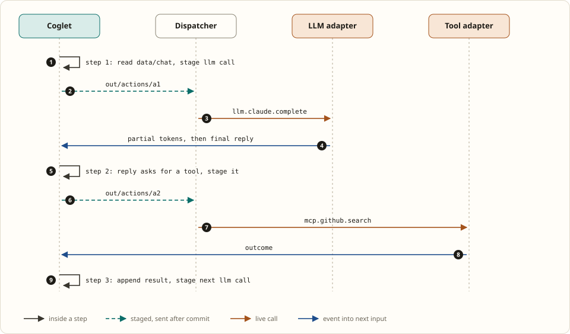

# LLMs on unforged

How coglets use language models when they run on unforged
([Coglets on unforged](unforged.md)): a model is just another adapter, an agent
loop is a chain of steps, and long-running harnesses run beside the cogent, not
inside a step. Part of the [cogent design](README.md).

Status: `proposed`. This changes the ABI, so it is a later stage in
[Staged integration](unforged-staging.md), not a change to make now.

## A model is just another adapter

Today the runtime treats model calls specially. The ABI has a built-in
`llm.complete` capability: a step stages an `llm-request`, the runtime sends it
after the step commits, the reply arrives as an `llm.reply` event, replies are
recorded verbatim, and a replay never calls a live model.

Every one of those properties is one we want for every outside call, not just
models. A replay should never call Stripe or GitHub again either. So this
design makes the generic action path do all of it, and the model becomes one
adapter among many:

| Today, for models only | Proposed, for every adapter |
|---|---|
| `llm.complete` host capability | Actions named `llm.<provider>.complete`, under `/net/llm/<provider>/` |
| `llm-request` effect kind | An ordinary staged action in `out/actions/` |
| `llm.reply` event | An ordinary outcome event |
| Replies recorded for replay | Every outcome recorded in input commits ([Secrets and adapters](secrets.md#one-call-end-to-end)) |
| Model routing in the runtime | Models listed in the LLM adapter's catalog |
| Spend tracked by the runtime | Budgets in the coglet's grant, enforced by the adapter |

The runtime gets smaller: one effect path, no special host functions for
models, and adding or swapping a provider is a catalog commit. The LLM adapter
holds the provider keys through the vault, like any other adapter.

Two things the generic path must handle well:

- **Streaming.** Voice needs tokens as they arrive. An outcome can therefore be
  a series of events: partial events carrying a sequence number, then one final
  event. Speech events (`speech.start`, `speech.partial`, `speech.end` in
  [the Softmax app](softmax-app.md)) already work this way, so the pattern
  generalises. Replays read the same recorded series.
- **Budgets.** A grant on `llm.*` carries limits: tokens or spend per period,
  and which models. The adapter refuses a call that would go over, and reports
  usage with each outcome so the coglet can see what it spent.

## An agent loop is a chain of steps



*An agent loop as steps. Each step stages one call and stops.*

A step must be short, metered and finished before anything goes out, so a
coglet cannot wait for a model inside a step. Instead the loop is unrolled:

1. The conversation lives in the coglet's own files, for example
   `data/chat/turns.jsonl`.
2. A step reads it, decides what to do, stages one model call, and stops.
3. The reply wakes the next step. If the reply asks for a tool, that step
   stages the tool call and stops; the tool's outcome wakes the step after.
4. Each step appends what it learned to the conversation.

What this buys:

- **Every turn is a commit.** A conversation can be replayed exactly, or
  forked at any turn to try a different prompt, model or tool result.
- **Forks reuse work.** A fork shares every step before the point where it
  changes, through unforged's cache. After that point it needs new model
  replies; those are live calls made by the LLM adapter on a hosted runtime and
  recorded into the fork's own inputs.
- **Tools and models are the same thing.** A model call and an MCP tool call
  are both staged actions with recorded outcomes.

## A prompt runner, so most coglets are words

Most coglets the cogent writes are mostly prompts and skills. So there is one
standard program, the **prompt runner**: a Wasm module that reads
`code/prompts/` and `code/skills/`, runs the loop above, and turns the model's
answers into actions. A coglet built on it is a manifest plus some markdown:

```idl
PromptCoglet
  # The tree of a coglet that uses the prompt runner.
  manifest.cbor          Manifest     Names the prompt runner as its resolver.
  code/prompts/system.md bytes        Who it is and what it does.
  code/skills/*.md       bytes        What it knows how to do.
  data/chat/turns.jsonl  bytes        Its conversation, written by the runner.
```

No compiler is involved in writing or patching one, which is what lets the
factory and the optimizer change coglets by editing text.

## What coglet code is written in

Whatever the resolver names. The resolver pins the engine that runs a coglet's
step, so:

- **Wasm, today.** `code/bin/step.wasm`, built with the Rust guest SDK. Anything
  that compiles to Wasm works in principle: C, Zig, Go via TinyGo,
  AssemblyScript.
- **Words, through the prompt runner.** The runner is Wasm; the coglet is text.
- **Other languages, through engines built as Wasm.** A coglet can be a
  JavaScript file whose resolver names a JavaScript engine compiled to Wasm.
  The engine stays metered and deterministic.

The hard rule is the same in every case: no ambient clock, randomness or
network. That rules out running ordinary Python libraries as they are.

## Harnesses run beside the cogent

A full harness such as Claude Code runs for minutes, makes dozens of calls and
edits a working tree. That does not fit in steps, and unrolling it would mean
rewriting the harness. So a harness runs as an adapter:

- It runs on a worker outside unforged, like the factory's existing
  `worker.control` adapter.
- A coglet starts a job, steers it and receives results as events. Results land
  in input commits like any outcome.
- Its own model and tool calls happen inside the worker. A replay of the coglet
  sees only the recorded events, not the harness's internal turns.

| Use | For |
|---|---|
| Unrolled loop with the prompt runner | Coglets whose policy is mostly prompts: the fast loop, Face, app coglets |
| Harness as an adapter | Heavy coding and long jobs: the factory |

## Open questions

- **Streaming into a step.** Should a coglet step on every partial event, or
  only on the final one with partials going straight to speech? Stepping on
  every partial is simple but makes many commits per reply.
- **Prompt caching across forks.** Forks that share a long prefix could share
  the provider's prompt cache. That needs the adapter to keep cache keys stable
  across forks.
- **Recording size.** Recorded model replies make input commits large. They
  are blobs and are shared when identical, but long transcripts still need
  compaction.
