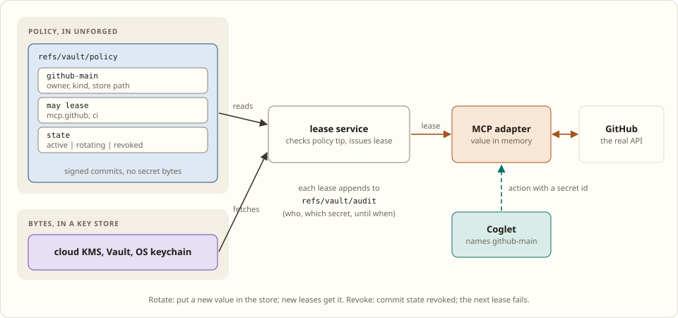
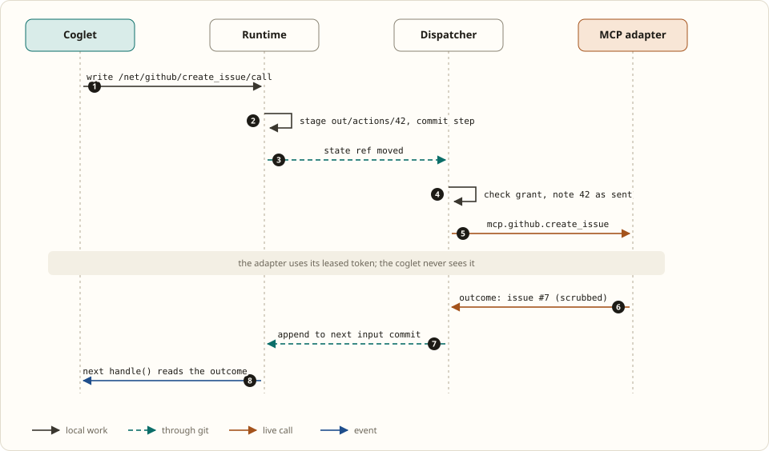

# Secrets and adapters

How a cogent holds API keys and OAuth tokens, how adapters use them, and how a
coglet reaches an outside API or MCP server without ever seeing a credential.
Written for coglets running on unforged ([Coglets on unforged](unforged.md));
most of it also holds for today's runtime. Part of the
[cogent design](README.md).

Status: `proposed`. Neither repo has a secrets spec yet; this page is the
proposal for one.

## Three rules

1. **Coglets never hold secrets.** A coglet names a credential by id; the bytes
   never enter its files, its logs, its commits or its traces. A replay on a
   hosted runtime needs no credentials at all.
2. **Only adapters use secrets.** The adapter is already the boundary that
   decides what is allowed, so it is the one that holds the token and makes the
   call. A coglet gets grants to actions, not to keys.
3. **Secret bytes never go into git.** Git never forgets: every clone, fetch,
   cache and CAOS translation keeps a copy, and deleting means rewriting history
   everywhere it spread. Encrypting the values does not fix that; if the key
   leaks, every old secret in every old clone leaks with it. So the policy
   about secrets lives in unforged, and the bytes live in a key store.

## The vault



*The vault: signed policy in unforged, bytes in a key store, short leases to
adapters.*

The vault is two parts.

**The policy** is a ref in the cogent's unforged repository,
`refs/vault/policy`. Its tree has one file per secret. Commits to it are signed,
and `allowed_signers` decides who may make them.

```idl
SecretRecord
  # vault/<id>.cbor in refs/vault/policy. Never contains the secret itself.
  id           str          Stable name, e.g. github-main.
  owner        UserId       The person or org it belongs to.
  kind         "api_key" | "oauth" | "password" | "certificate"
  store        str          Where the bytes live, e.g. kms:projects/p/secrets/github-main.
  may_lease    [AdapterId]  Adapters allowed to use it.
  lease_ttl    duration     How long one lease lasts. Default 15 minutes.
  state        "active" | "rotating" | "revoked"
```

**The bytes** live in a real key store. On a hosted runtime that is a cloud key
manager or HashiCorp Vault; on a device it is the OS keychain or secure
enclave. Git refers to them only by `store` path.

**Leases.** An adapter asks the lease service for a secret, authenticating with
its node key. The service reads the policy at its current tip, checks that the
adapter is in `may_lease` and the secret is `active`, fetches the bytes and
returns them with an expiry. The adapter keeps the value in memory only: never
on disk, never in a log, never in an outcome. Every lease appends a record to
`refs/vault/audit` (which adapter, which secret, which policy commit, until
when), with no value in it.

| Operation | How |
|---|---|
| Add a secret | Put the bytes in the store; commit a `SecretRecord` |
| Rotate | Put a new value in the store and mark `rotating`; new leases get the new value; mark `active` once old leases expire |
| Revoke | Commit `state: revoked`; the next lease fails, and the router tells adapters holding a lease to drop it |
| Audit | Read `refs/vault/audit` and the policy's signed history |

Device secrets that exist today (the runtime's identity key and its one-time
invite) stay as they are: private files on the device, never in git, never on a
command line.

## Adapters as mounts

unforged lays out each instance as a Linux filesystem. It already has
`/net/<host>/<repo>`: remote repositories mounted lazily on first use,
configured as remotes in `/etc/config`, listed in the generated `/etc/fstab`
and `/etc/auto.master`, with freshness in `/var/cache/autofs`. Adapters become a
second kind of `/net` mount.

```idl
AdapterMount
  # /net/<adapter>/ inside a coglet's view.
  /net/github/                       One directory per adapter the coglet is granted.
  /net/github/create_issue/          One directory per tool.
  /net/github/create_issue/@xattr/schema   The tool's input schema.
  /net/github/create_issue/@xattr/effect   "read" or "write".
  /net/github/create_issue/call/<id>       Writing here stages a call.
```

- **Listing is reading the catalog.** What appears under `/net/github/` is the
  adapter's catalog (below) at the commit pinned in this step's input, filtered
  by the coglet's grants. A step sees the same listing in a live run and in a
  replay.
- **Writing stages; it never calls.** Writing a request to `…/call/<id>` is
  the same as staging `out/actions/<id>`. Nothing leaves until the step
  commits, exactly as for any other action.
- **On the cold path, calls go through `fd 3`.** unforged already gives every
  sandboxed process a capability socket on file descriptor 3. Staging an
  adapter call becomes a new operation on it, so a process can only reach the
  adapters it was handed. On devices there is no sandboxed process per step:
  `cogletd` stages the call itself, against the same grants.
- **The catalog names the action.** A tool's mount path is
  `/net/<mount>/<tool>/`, and its action name is the `name` in its catalog
  entry; the catalog maps one to the other. For example
  `/net/github/create_issue/` is `mcp.github.create_issue`, and
  `/net/llm/<provider>/complete/` is `llm.<provider>.complete`.
- **Not `/dev`.** In unforged, `/dev` is the git directory, not devices.

### One call, end to end



*A coglet opens a GitHub issue. The token stays in the adapter.*

1. The coglet writes a request to `/net/github/create_issue/call/42`.
2. The runtime stages it as `out/actions/42` and commits the step.
3. The dispatcher sees the state ref move, checks the grant, and notes action
   42 as sent in `refs/notes/dispatched`, so it is never sent twice.
4. The adapter makes the call with its leased token.
5. The outcome comes back as an event. The adapter scrubs it first: any string
   that matches a value it holds is removed.
6. The dispatcher appends the event to the next input commit, which wakes the
   coglet.

Because every outcome lands in an input commit, a replay reads the recorded
outcome and never calls the live service.

## The catalog and grants

Each adapter publishes what it offers as a ref, `refs/adapters/<name>/catalog`.

```idl
AdapterCatalog
  # The tree of refs/adapters/<name>/catalog.
  adapter.cbor     AdapterDef
  tools/<tool>.cbor ToolDef

AdapterDef
  kind         "mcp" | "openapi" | "composio" | "native"
  endpoint     str          MCP server URL, OpenAPI base URL, or Composio toolkit.
  credentials  [SecretId]   Secrets it leases. Ids only.
  accounts     [Account]?   Connected user accounts, for per-user services.

ToolDef
  name         str          Action name, e.g. mcp.github.create_issue.
  schema       JSONSchema   Its input.
  effect       "read" | "write"
  approval     "none" | "person" | "kernel"   Who must accept a write before it runs.
```

Grants for each coglet live in `refs/grants/<coglet>`, signed by whoever may
grant. Admitting a coglet checks its manifest's `needs` against the catalogs
and its grants. Grants are per tool, so a coglet can hold
`mcp.github.search` without `mcp.github.create_issue`.

- **Read tools** run within their grant without a further check.
- **Write tools** go through the adapter's accept-or-refuse step, where the
  tool's `approval` can require a person or the kernel.

## The MCP adapter

One adapter wraps any number of MCP servers or plain APIs.

- **Tools become actions.** Each MCP tool is an action named
  `mcp.<server>.<tool>`, so the normal grant system applies per tool.
- **Tool lists become catalog commits.** When a server's tool list changes, the
  adapter commits a new catalog. A new read tool is available to coglets
  already granted the server; a new or changed write tool needs approval again.
- **Credentials come from the vault.** The adapter leases each server's API key
  or OAuth token and injects it on the call.
- **Results are scrubbed and recorded.** Outcomes go through the same scrubbing
  and land in input commits.

## Connecting a new API

A coglet can ask for a new API. It can never hand itself a credential or a
grant.

1. **Propose.** The coglet, or the factory on its behalf, writes an adapter
   definition (an MCP server address, or an OpenAPI spec and the endpoints to
   expose) and proposes it as a commit on `refs/adapters/proposed/<name>`.
2. **Approve.** A person or the kernel reviews it, adds a secret to the vault,
   lists it in the definition, and moves the proposal to
   `refs/adapters/<name>/catalog` with a signed commit. This is the only step
   where trust and secrets enter.
3. **Use.** The adapter starts, leases its secret, and its tools appear under
   `/net/<name>/`. The coglet asks for grants to the tools it needs, through
   the usual grant path.

## Composio and WorkOS

These fit different layers.

**Composio is a back end for the MCP adapter.** Instead of one adapter per
service, one Composio adapter exposes each enabled toolkit as its own mount,
such as `/net/composio/gmail/` or `/net/composio/linear/`. Composio stores each
user's OAuth tokens and refreshes them, so the vault holds one Composio API key
plus, in the catalog, which Composio account belongs to which user. That
mapping is not secret. Enabling a service is a catalog commit.

**Connecting an account is dynamic.** If a coglet calls a tool whose account is
not connected, the outcome is `needs_auth` with an authorization link. Face
shows the link or reads it out; the person approves; the adapter records the
connection in the catalog; the next call works. The coglet only ever learns
whether the account is connected.

**WorkOS is for people, not tools.** It answers who someone is and what they may
approve: sign-in, single sign-on and organisation membership. Its user ids map
to the signer keys that approve vault and grant commits, and it authorises
outside callers of the cogent's own MCP endpoints.

**Trade-off.** Composio is a third party that holds users' tokens and sees
every call. That is fine for a prototype. The adapter interface stays generic
so Composio can be swapped for direct MCP servers.

## Open questions

- **Device-only secrets.** Some credentials should never leave a device, such
  as a local app's login. The lease service then runs on the device against the
  OS keychain; how its policy syncs with the cogent's is open.
- **Scrubbing limits.** Exact matching catches a leaked value, not a derived
  one. Adapters for services that echo credentials need their own rules.
- **Approval latency.** A write tool that needs a person blocks until someone
  answers. Coglets need a way to keep going and handle the outcome when it
  arrives, which the event model already supports.
