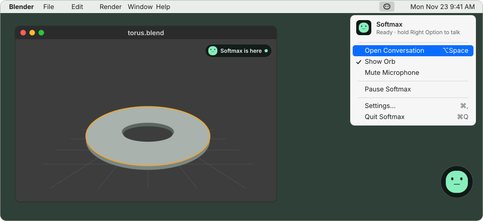
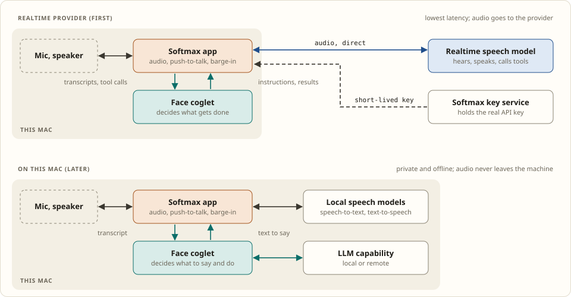

# The Softmax app

An app the user can install. Part of the [cogent design](README.md).

**Any app can host a runtime** and run coglets: a game, Blender, a browser, a
phone app ([ADR-0039](../adr/0039-hubs-and-coglets-on-unforged.md)). The Softmax
app is one host among them, useful on a computer where no other app hosts one.
It does three things:

1. **It is the user's way in.** A menu bar icon, a floating orb, and
   push-to-talk.
2. **It provides capabilities.** Through its adapter, coglets can listen, speak,
   change the orb's expression and add to the menu.
3. **It has a runtime and runs coglets locally,** on the user's own machine.

## What the user sees



*A mock-up using the real app's menu bar icon and face from `apps/softmax-mac`.
The icon lives in the menu bar; the orb floats over whatever the user is
working in.*

| Part | What it is for |
|---|---|
| Menu bar icon | Always there. Shows whether the app is listening, and opens the menu. |
| Menu | Kept short: open the conversation, show or hide the orb, mute, pause, settings, quit. Connected apps and the list of running coglets are not here; they are in Settings. |
| In-app indicator | A small badge in the corner of a connected app's window, showing that the cogent is in there with you. |
| Floating orb | The face the user talks to. It shows expression (listening, thinking, speaking) and what it just said. |
| Push-to-talk | Hold a key to speak. Nothing is heard unless it is held. |

## Capabilities it provides

The app's adapter exposes the machine's microphone, speaker and screen presence
to the coglets it runs. Each is granted separately.

| Capability | What a coglet can do | What it is told |
|---|---|---|
| Listening | Nothing to do; the app captures and transcribes. | When the user starts and stops speaking, and the transcript. |
| Speaking | Say a chunk of text, stop, give a short acknowledgement. | How much has actually been played, and when the user interrupts. |
| Orb | Set the orb's expression. | Its current expression. |
| Push-to-talk | Nothing to do. | When the key is pressed and released. |
| Menu | Add and remove menu items. | Which item the user chose. |
| Connected apps | Ask to connect an app the user has installed. | Which apps are installed, and which the user agreed to connect. |

Listening, speaking and the orb are defined in detail below. Push-to-talk,
the menu and connected apps are not defined yet.

Voice never passes through Softmax infrastructure. The app transcribes locally
or sends audio straight to the speech provider. The app also stops speaking the moment the user talks over it, without
waiting for any coglet.

## Speech

Speech is the main way in, so it has to feel instant. Two speech engines are
planned. Coglets see the same events from either one, so they can be swapped
without changing any coglet.



*Top: a realtime provider, which we build first. Bottom: models running on the
Mac, which come later.*

| | Realtime provider | On this Mac |
|---|---|---|
| What it is | A speech-to-speech model in the cloud, OpenAI's realtime API first. | Local speech-to-text and text-to-speech models. |
| Where audio goes | Straight from the app to the provider. Never through Softmax infrastructure. | Nowhere. It stays on the machine. |
| Who writes the reply | The speech model, guided by instructions and tools from the Face coglet. | The Face coglet, using its LLM capability. |
| Strength | Lowest latency, natural interruptions. | Private, works offline, no per-minute cost. |
| When | First. | Later, as an option in Settings and as the fallback when offline. |

### What stays the same in both

- **The app owns the audio.** It holds the microphone and speaker, handles
  push-to-talk, and stops speaking the instant the user talks over it. No
  coglet touches raw audio.
- **Push-to-talk decides the turn.** Holding the key starts listening and
  releasing it ends the turn. We do not rely on the engine to guess when the
  user has finished. A hands-free mode can come later.
- **The Face coglet decides what gets done.** Anything beyond talking (driving
  an app, remembering something, asking the cogent) goes through it.
- **The Face coglet keeps the record.** It receives the text of what the user
  said and of what was actually spoken back, so its memory holds the
  conversation whichever engine did the talking.
- **Interruptions are honest.** When the user cuts a reply short, the record
  holds only the part that was really played.

### With a realtime provider

1. **Key.** The app asks Softmax for a short-lived key. The real API key stays
   on our server and never ships in the app.
2. **Connect.** The app opens a direct, low-latency connection to the provider
   and keeps it warm while the user is active, so the first word is not slow.
3. **Set up.** The Face coglet supplies the session's instructions (persona,
   which apps are connected) and a small set of tools.
4. **Talk.** While the key is held the app streams the microphone. On release
   it tells the model the turn is over, and the model answers in audio, which
   plays as it arrives.
5. **Act.** When the user asks for something real, the model calls a tool
   instead of answering. The app passes the call to the Face coglet, which
   sends the request on to the right coglet and returns the result for the
   model to say.
6. **Slow work.** If the work takes a while, the Face coglet answers "started"
   straight away so the model can say so, and pushes the outcome into the
   conversation when it is done.
7. **Interrupt.** If the user talks over a reply, the app stops playback at
   once and tells the provider how much was actually heard, so both sides
   agree on what was said.

The tools are few and general, so adding an app never means changing the
speech session:

| Tool the model can call | What the Face coglet does with it |
|---|---|
| `do(app, request)` | Sends a `UserIntent` to a coglet that drives that app. |
| `ask(question)` | Asks the cogent, for anything it may know or remember. |
| `remember(note)` | Stores a note. |

### With models on this Mac

1. While the key is held, a local speech-to-text model turns the audio into a
   transcript as it goes.
2. On release, the app sends the transcript to the Face coglet.
3. The Face coglet decides what to say and do, using its LLM capability, which
   can itself be a local model or a remote one.
4. It sends back text in short chunks, and a local text-to-speech model speaks
   them as they arrive.

There is no speech model in the middle here, so there are no tool calls: the
Face coglet does the deciding directly.

### What a coglet sees

The same events and actions for either engine:

| Direction | Message | Meaning |
|---|---|---|
| App to coglet | `speech.start`, `speech.partial`, `speech.end` | The user started, is still, and has finished speaking, with the transcript. |
| App to coglet | `speech.position`, `speech.barge_in` | How much of a reply has been played, and that the user interrupted. |
| App to coglet | `speech.tool_call` | The speech model wants something done. Realtime only. |
| Coglet to app | `speech.speak_chunk`, `speech.stop` | Say this; stop talking. |
| Coglet to app | `speech.session_open`, `speech.session_close` | Start and end a realtime session. |
| Coglet to app | `speech.tool_result` | The answer to a tool call. Realtime only. |

### Choosing and falling back

- Settings has one speech choice: **Realtime** or **On this Mac**.
- If the network or the key service is unavailable, the app falls back to local
  models when they are installed, and to typing in the conversation window
  when they are not. It says which.
- The menu bar icon and the orb always show when the microphone is live.

### Still to decide

- **How much the realtime model says on its own.** The plan above lets it chat
  freely and call tools for anything real, which is fastest. The stricter
  alternative is to use it only as ears and a voice, with the Face coglet
  writing every reply; that is slower but gives full control over what is said.
- **How long to keep a realtime session warm** after the user stops talking.
  Longer is snappier and costs more.
- **Which local models,** and whether they ship with the app or download on
  first use.
- **Whether transcripts are kept** by default, and for how long.

## It runs coglets locally

The app contains a [runtime](coglets-and-runtime.md#runtime), and like every
runtime that joins a cogent it runs a [hub](README.md#hub): a router and an
optimizer. The coglets that need to be close to the user run there too, on the
user's machine:

- [Face](README.md#face), which listens, watches the screen, and drives this
  app's own UI using the capabilities above;
- the coglets that drive the apps the user has connected, using
  [those apps' adapters](app-integration.md#adapter).

Running them locally keeps conversation fast, keeps voice off Softmax
infrastructure, and
lets the coglets reach apps that only exist on this computer.

On first run the orb notices what is installed ("I see you have Blender, can
I connect to it?"). When the user agrees, the app installs a coglet for it
into its runtime and links it to the app's adapter. Connecting more apps just
means more coglets.

Quitting the app, or choosing Pause Softmax in the menu, stops every coglet it
runs. The user does not need to know which coglets those are; the list is in
Settings, under Advanced.

## Capability detail

### Softmax app adapter: `speech.control`

Exclusive resources: `audio.mic`, `audio.speaker`. Capture, echo cancellation,
voice detection and the barge-in reflex all run in the adapter, outside any
coglet step.

```idl
-- events, adapter to coglet

SpeechStart
  utterance    Id
  position_ms  u64  Position on the capture timeline.

SpeechPartial
  utterance  Id
  revision   u64  Starts at 1 and strictly rises within an utterance.
  text       str  The whole hypothesis so far, not a delta.

SpeechEnd
  utterance    Id
  revision     u64
  text         str  The final transcript. May be empty.
  position_ms  u64

SpeechPosition
  stream       Id
  chunk        u64
  item         Id                              The action id of the chunk being played.
  played_ms    u64                             Audio actually rendered within this item.
  position_ms  u64
  state        "playing" | "ducked" | "stopped" | "finished"

SpeechBargeIn
  # The user spoke over the output and the adapter already reacted.
  utterance    Id
  stream       Id
  item         Id
  played_ms    u64
  position_ms  u64
  reflex       "stopped" | "ducked"

-- actions, coglet to adapter

SpeakChunk
  # `speech.speak_chunk`. Succeeds once the chunk has actually played.
  stream  Id
  chunk   u64                Contiguous from 0. At most 64 per stream.
  text    str 1..4096 chars
  final   bool

Stop
  # `speech.stop`. Succeeds when the stream is silent.
  stream  Id

Backchannel
  # `speech.backchannel`. A short acknowledgement on its own stream.
  stream  Id
  cue     "ack" | "thinking" | "agree"
```

The same entry also defines the read `speech.config`. Three more entries are
defined in `spec/capabilities/speech.md` and not written out here:
`speech.session`, which the realtime engine above uses, `speech.history` and
`speech.work`.

### Softmax app adapter: `expression.control`

Exclusive resource: `display.face`.

```idl
Expression = "neutral" | "listening" | "thinking" | "speaking" | "happy" | "concerned"

SetExpression
  # `expression.set_expression`. A meaning, not an animation id: a Mac draws a face, an Echo Dot
  # lights its ring.
  expression   Expression
  intensity    int 0..1000
  duration_ms  int 0..60000  Reverts to neutral afterwards. Zero resets now.

ExpressionState
  # Result of the read `expression.state`.
  expression    Expression
  intensity     int 0..1000
  remaining_ms  int 0..60000
```

The Softmax app's adapter also covers push-to-talk and the menu. Those
operations are not defined yet.
