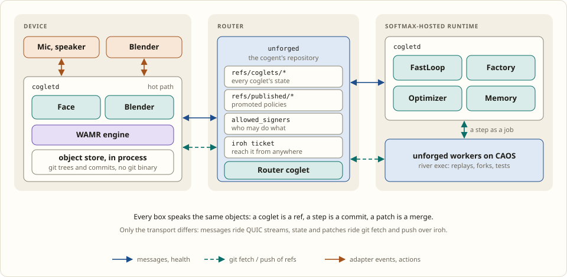
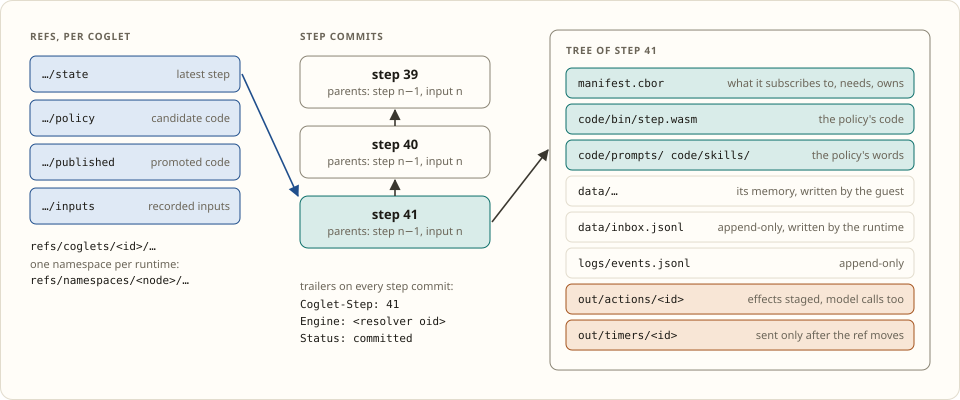
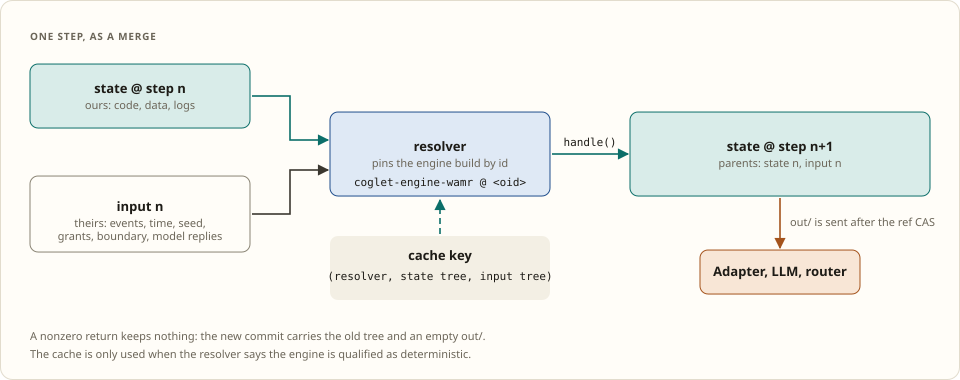
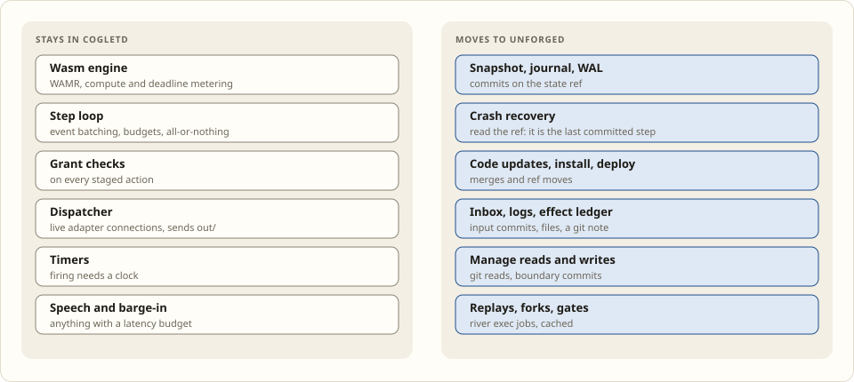
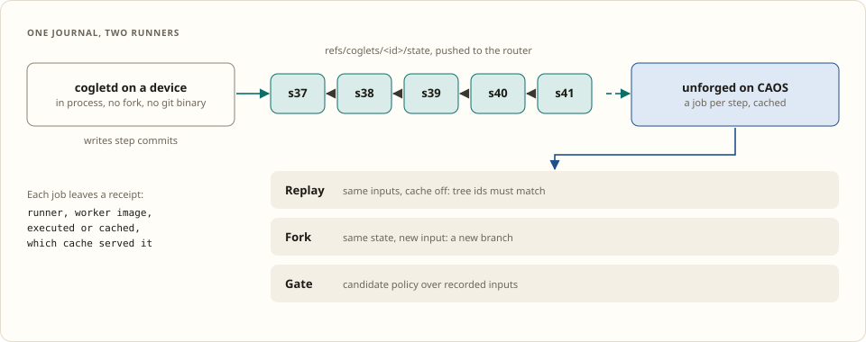
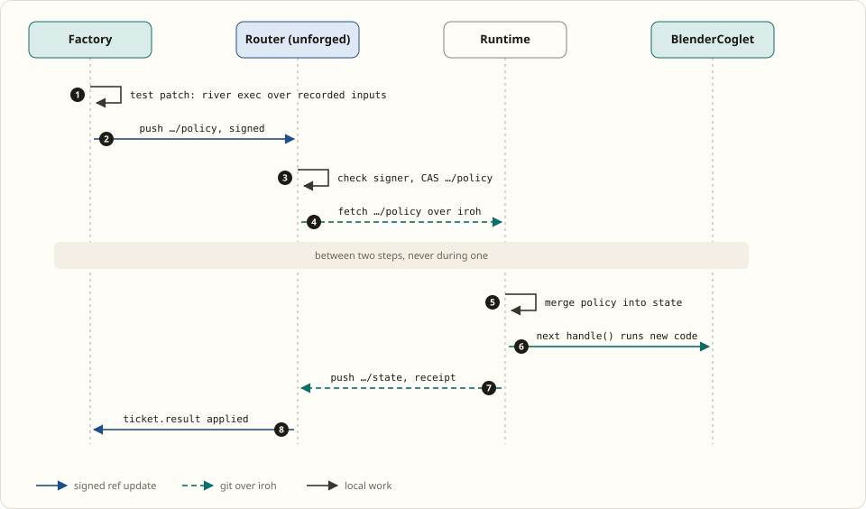

# Coglets on unforged

How coglets are stored, stepped, patched and shipped if the cogent's
storage and execution layer is [unforged](https://github.com/softmax-universe/unforged):
a coglet is a git ref, a step is a commit, a patch is a merge, and the
router is an unforged repository. Part of the [cogent design](README.md).

Status: `proposed`. Nothing here is frozen. Adoption is staged: only the
state-hash change is planned now; see
[Coglets and unforged: staged integration](unforged-staging.md). Where this page and the specs
disagree, this page describes the intended change; the
[spec changes](#spec-changes) section lists what each spec would need.

This design runs against one decision already on main:
[ADR-0031](../adr/0031-manage-port-and-filesystem-patches.md) keeps Git out of
coglets (§2–§5): a coglet holds plain files, a patch is a set of whole files
with a tree hash as its `base`, and tree identity is the `coglet-fs` CBOR hash.
Adopting this page would supersede those sections and needs its own ADR.

## The idea

Today a coglet's state is a flat map of files hashed as one CBOR value, its
journal is a separate trace format, and code reaches a device as a git bundle.
Three formats describe one thing. This design keeps one: **git objects with
SHA-256 ids**, the format unforged is already built on.

| Coglet concept | Becomes |
|---|---|
| A coglet | A ref, `refs/coglets/<id>/state` |
| Its memory, code and logs | The tree of the commit that ref points at |
| One step | One commit, with the previous state and the step's input as parents |
| The state hash | The git tree id of that commit |
| The journal | The ref's history |
| A patch | A commit on `…/policy`, merged into the state between steps |
| Promotion | A signed compare-and-swap of `refs/published/<id>` |
| The router's store | An unforged repository holding every coglet's refs |

What does not change: adapters, events and actions, `handle()`, all-or-nothing
steps, grants, and the rule that nothing leaves a runtime until a step has
committed. Coglets do not see any of this; their code still reads and writes
`/data` and returns.



*Three places, one object format. Devices step coglets in process. The router
is an unforged daemon. A Softmax-hosted runtime steps its coglets the same way and can
send any step to unforged workers on CAOS.*

**Two speeds.** unforged as it stands runs every program as a separate process
and calls the `git` binary for most operations. That is fine for jobs and far
too slow and too heavy for a voice turn on a phone. So the design has two
runners that produce the same objects:

- the **hot path**, `cogletd`, which writes git objects in process with no
  fork and no `git` binary, on every device;
- the **cold path**, unforged's `river exec`, which runs one step as a cached
  job, on Softmax-hosted runtimes or on CAOS workers.

The rule that ties them together: **for the same state and the same input,
both runners produce the same commit id.** That is the conformance check.

## A coglet is a ref



*The refs of one coglet, its step commits, and the tree of the latest one.*

Each coglet has four refs under `refs/coglets/<id>/`:

| Ref | Points at | Moved by |
|---|---|---|
| `state` | The commit of its latest step | The runtime, once per step |
| `policy` | Candidate code, prompts and skills | Its manager: the factory, the optimizer or a person |
| `published` | The policy the cogent has promoted | The router kernel, after probation |
| `inputs` | The latest recorded input | The runtime, once per step |

On the router, each runtime's refs live in their own namespace,
`refs/namespaces/<node>/refs/coglets/<id>/…`, so a device can only ever move
its own refs. unforged already gives each process its own `GIT_NAMESPACE`;
here a namespace is a runtime instead of a process.

```idl
CogletTree
  # The tree of every step commit. Paths are the ABI's paths without the leading slash.
  manifest.cbor        Manifest   What it subscribes to, needs and owns. Host-owned.
  code/bin/step.wasm   bytes      The policy's code. Host-owned.
  code/prompts/…       bytes      Prompts, if the policy has any. Host-owned.
  code/skills/…        bytes      Skills, if the policy has any. Host-owned.
  data/…               bytes      Its memory. The guest writes these.
  data/inbox.jsonl     bytes      Append-only. Only the runtime writes it.
  logs/events.jsonl    bytes      Append-only.
  out/actions/<id>     Action     Effects this step staged, model calls included. Empty after a failed step.
  out/timers/<id>      Timer
```

Rules for the tree:

- Every file is a regular file with mode `100644`. No symlinks, no gitlinks,
  no `.git*` entries, no empty directories. The ABI already forbids symlinks,
  hardlinks and device nodes; it would also have to forbid `.git` names and a
  path that is both a file and a directory, so that every valid snapshot maps
  to exactly one tree and back.
- `out/` holds only what this step staged. The next step starts with `out/`
  empty. A dispatcher reads `out/` from the commit the `state` ref points at
  and records what it sent in `refs/notes/dispatched`, keyed by commit; that
  note, not the tree, is the effect ledger.
- `code/` and `manifest.cbor` change only through a patch, never through a
  step.

## A step is a merge

unforged's central idea is that running a program is a three-way merge:
program ⊕ input → output. A coglet step fits it exactly. The coglet's state is
"ours", one input is "theirs", and the resolver names the engine that merges
them.



*One step. The resolver pins the engine build by id, so the cache key
covers which engine ran, not just which coglet.*

```idl
InputTree
  # Everything one step reads besides the coglet's own tree. One commit per step.
  events.cbor       [Event]    The batch, oldest first.
  context.cbor      StepContext
  boundary.cbor     [Change]   Manage writes and inbox appends applied before this step.
  replies/<id>      bytes      Model replies and read results delivered as events, verbatim.

StepContext
  step          u64
  logical_time  u64
  seed          u64
  grants        [OpName]
  budgets       Budgets

StepCommit
  # Built so that replaying the same step yields the same commit id.
  tree       TreeId     The coglet's tree after the step.
  parents    [state n, input n]
  author     the coglet id, at logical_time
  committer  the coglet id, at logical_time
  message    "step <n>"
  trailers   Coglet-Step: <n>
             Engine: <resolver commit id>
             Status: committed | aborted
```

Decisions this makes:

1. **The state hash is the git tree id.** It replaces the SHA-256 of the
   whole snapshot as one CBOR map. A step that changes one file rehashes that
   file and the trees above it, not every byte the coglet owns. Any git tool
   can check it.
2. **Step commits are deterministic and unsigned.** Author and committer
   are the coglet at logical time; there is no wall-clock time and no
   signature in the commit. Replaying a step must reproduce the exact commit
   id, which is a stronger check than comparing state hashes. Signatures go
   on ref updates instead (see [Signatures](#signatures)).
3. **Observed usage is not in the commit.** Compute used, wall time and
   memory high-water go in `refs/notes/usage`, because wall time differs
   between runs.
4. **A failed step still makes a commit.** Its tree is the previous tree with
   `out/` empty, and its trailer says `Status: aborted`. The step counter and
   the inputs it consumed stay in history, as the journal requires today.
5. **The engine is part of the input.** The resolver tree pins the engine
   build (for example `coglet-engine-wamr` at a given id) and says whether
   that engine is qualified as deterministic. The cache key is
   `(resolver, state tree, input tree)`, so changing the engine can never
   reuse a result from another engine.

## Two runners

| | Hot path: `cogletd` | Cold path: unforged `river exec` |
|---|---|---|
| Where | Every runtime with live coglets, devices and hosted | Softmax-hosted runtimes and CAOS workers |
| Process model | One process; steps run in it | One sandboxed process per step |
| Git | In-process object writer; no `git` binary | unforged, which calls `git` |
| Engine | WAMR, with compute and deadline metering | The same engine build, named by the resolver |
| Writes | Step commits, moved with a local ref compare-and-swap | The same commits, plus a cache entry and a receipt |
| Cache | None: every live step runs | `refs/notes/memoization` locally, CAOS's cache remotely |
| Used for | Live work: voice, apps, the fast loop | Replays, forks, gates, factory tests, simulations |

**The hot path.** `coglet-fs` becomes a git-tree store: blobs and trees are
written in process as SHA-256 git objects, loose at first and packed in the
background. The `state` ref is updated with a compare-and-swap in a small ref
store of its own. Nothing forks, so it works on iOS and the EO1. Commits are
cheap: a step that changes one file writes one blob, the trees above it, the
input commit and the step commit.

**The cold path.** A step becomes an unforged job: the program tree holds the
engine and a small driver, `coglet-step`, that runs exactly one step and
writes the output tree; the input is the coglet's state merged with one input
commit. unforged takes care of sandboxing, caching, provenance trailers and,
with a `caos://` ticket, running the job on a CAOS worker.

**Commit always, flush in groups, push rarely.** A voice turn can step a
coglet many times a second, so the three clocks are kept apart:

- **Commit** every step, in memory: hashing a few small objects and swapping
  a ref. The step rate is bounded by batching, since the runtime folds every
  event that arrived during a step into the next one; raw audio frames are
  never events, only partials and end of utterance.
- **Flush** to disk in groups, every 100 ms or so, and always before an action
  that matters leaves the device. Speech output may leave after the in-memory
  commit; a crash then loses at most the last fraction of a second.
- **Push** the `state` tip to the router every few seconds or at the end of a
  turn. Intermediate commits stay local and are later compacted into
  checkpoints.

## What stays in the runtime



*The runtime becomes an engine, a scheduler and a dispatcher on top of an
object store.*

Most of what `cogletd` does today is storing and moving state. All of that
can become git:

| Today in the runtime | On unforged |
|---|---|
| Snapshot, journal, write-ahead log | Commits on the `state` ref |
| Crash recovery | Read the `state` ref: it is the last committed step |
| Code updates and update fencing | A merge of `policy` at the next boundary |
| Install, push, deploy | Ref moves the device fetches |
| Inbox, logs, effect ledger | Input commits, files in the tree, `refs/notes/dispatched` |
| Manage-port reads and writes (`manage.read`, `manage.write`) | Git reads of a commit; boundary commits |
| Replays, forks, gates | `river exec` jobs, cached |
| The `llm.complete` capability | An adapter like any other ([LLMs on unforged](llms.md)) |

What stays is what must be fast, local or metered: the Wasm engine and its
metering, the step loop with batching and budgets, grant checks on each staged
action, the dispatcher and its live adapter connections, timers (firing one
needs a clock), and anything with a latency budget, such as speech playback and
barge-in.

## Replays, forks and gates



*The device writes the journal; a hosted runtime re-runs it.*

| Use | What runs | Passes when |
|---|---|---|
| **Replay** | Each recorded step, with the cache turned off | Every commit id matches the recorded one |
| **Fork** | A recorded state with a new input | Always; the result is a new branch |
| **Gate** | A candidate policy over recorded inputs | The kernel's promotion checks hold on the new branch |

Because every step is keyed by `(resolver, state tree, input tree)`, a
thousand forks that share a prefix share the work for that prefix, and two
factory tickets that test the same patch on the same inputs run it once.

Each job leaves a receipt, so a cached answer is never mistaken for a fresh
run:

```idl
StepReceipt
  # Kept in refs/notes/receipts, keyed by the step commit.
  runner        "cogletd" | "unforged" | "caos"
  worker_image  str?       The resolved worker image, for CAOS jobs.
  executed      bool       False if a cache supplied the result.
  cache         "none" | "local" | "caos"
  commit        CommitId
```

Rules:

- **Replay always executes.** A replay that a cache answers proves nothing,
  so replay jobs run with the cache off and their receipts must say
  `executed: true`.
- **Only qualified engines are cached.** A resolver that is not marked
  deterministic is never cached and never shared through CAOS.
- **Model calls never run in a replay.** Replies are blobs in the input tree;
  a missing reply fails the step, as today.

## Patches are merges



*A patch from the factory to a running coglet. Steps 5 and 6 happen between
two of the coglet's steps.*

A patch is a commit on `refs/coglets/<id>/policy`. Its tree changes
`code/`, may change `manifest.cbor`, and may carry a migration program for
`data/`. Applying it is a merge of the policy into the state, governed by the
coglet's resolver:

```idl
PatchAttributes
  # The resolver's attributes for applying a patch.
  code/**         merge=theirs     The patch's code replaces the old code.
  manifest.cbor   merge=manifest   The new manifest is admitted again against the coglet's grants.
  data/**         merge=migrate    Runs the patch's migration program, if it has one; otherwise keeps data.
  logs/**         merge=ours       Logs are never patched.
```

- **`base` is a compare-and-swap.** Here `Patch.base` is the `policy` commit
  the patch was made from, and the push is refused if the ref has moved. Under
  ADR-0031 `base` is a tree hash over plain files with the same refusal; this
  design would make it a commit.
- **A conflict pauses the coglet.** If the migration fails or the new
  manifest asks for more than is granted, the merge stops with a conflict
  tree, the coglet is `paused`, and its manager resolves it through the manage
  port. This is unforged's `PAUSED_CONFLICT` with a coglet as the process.
- **The patch is tested the same way it is applied.** The factory merges the
  patch into recorded states and runs the recorded inputs through it as a
  gate before pushing. That is the "build, test" step in the
  [end-to-end request](README.md#a-request-end-to-end).

The manage port maps onto git operations:

| Manage port | Becomes |
|---|---|
| `patch` | Push to `…/policy`; the runtime merges it at the next boundary |
| `tail_log` | Fetch of `logs/` from new step commits; live tailing stays a stream |
| `read_state` | Partial fetch of one path from the `state` commit, needing a read grant |
| `status` | The `state` ref, its last trailer, and health |
| `pause`, `step` | Unchanged messages; a paused coglet's ref simply stops moving |

## Adapters, secrets and models

A step on unforged is a pure merge, so it can never call anything outside.
Everything outside is an adapter, reached the same way:

- **Adapters are mounts.** Each adapter a coglet is granted appears under
  `/net/<adapter>/`, a new kind of unforged's lazy `/net` mount. Listing a
  directory reads the adapter's catalog; writing a call stages an action in
  `out/`; the outcome comes back in the next input commit. See
  [Secrets and adapters](secrets.md).
- **Secrets never enter git.** Policy about secrets is a signed ref,
  `refs/vault/policy`; the bytes live in a key store and reach adapters as
  short leases. Coglets name secrets by id only. See
  [Secrets and adapters](secrets.md#the-vault).
- **A model is an adapter.** Model calls stop being a special runtime
  capability; agent loops are chains of steps, and long harnesses run as
  adapters beside the cogent. See [LLMs on unforged](llms.md).
- **Coglet code is whatever the resolver names.** Wasm today; text through a
  standard prompt runner; other languages through engines built as Wasm.

## The router is an unforged repository

The router stays what [the cogent design](README.md) says it is: a
coglet that finds devices and carries messages and patches. unforged is its
storage and its git transport.

- **One repository per cogent.** Every coglet's refs, namespaced by runtime.
  `refs/published/<id>` and the kernel's probation refs live outside the
  runtime namespaces, and only the kernel moves them.
- **Install, start and deploy become ref moves.** To install a coglet on a
  device, the router moves the device's `published` ref; the device fetches it
  over iroh and starts the coglet from that tree. `coglet deploy` becomes a
  signed push to the router. This is the chain the CLI's `deploy` command is
  waiting for today.
- **Messages stay on streams.** Messages, health, `pause` and `step` keep the
  router protocol's QUIC streams. Only state, code and logs move as git, on a
  separate ALPN on the same iroh endpoint.
- **Private data stays private.** A runtime pushes its `state` commits with
  `data/` blobs left out, as a partial push; the router holds the trees and
  ids but not the bytes. Fetching `data/` blobs needs the same read grant as
  `read_state`, and replays on another runtime need it explicitly. This keeps the
  current rule that `/data` never leaves a device without a grant.

## Signatures

- **Step commits are not signed** (they must replay to the same id). The
  runtime signs each ref update instead: a statement naming the ref, its old
  commit and its new commit, as `ref-statement` does today, with the same
  Ed25519 node keys. The router keeps those statements in
  `refs/notes/statements`.
- **Policies and promotions are signed by whoever moves the ref**: the
  factory or a person for `policy`, the kernel for `published`. unforged's
  `allowed_signers` holds those keys and which refs each may move.
- **Signatures survive translation.** When objects pass through a store with
  other ids, such as CAOS's SHA-1 store, the original signed commit id is
  kept in a `Source-Commit:` trailer and that is what is verified. A
  translated object never counts as signed by its original author. The better
  fix is for CAOS to store SHA-256 objects, and this design asks for it.

## What it costs

| Cost | Mitigation |
|---|---|
| A few object writes per step on every device | Writes are in process, batched to disk, and packed in the background |
| History grows with every step | Compaction: keep recent steps, roll older ones into checkpoints (`river compact` / `gc` already exist) |
| Recorded model replies make inputs large | Replies are blobs, shared when identical, and dropped with old inputs |
| The cold path needs `git` and process spawning | Only on hosted runtimes and workers, never on devices |
| Two runners can drift | Conformance runs every fixture through both and compares commit ids |

## Spec changes

| Spec | Change |
|---|---|
| `spec/conventions.md` | Object ids are git SHA-256. CBOR stays for message and file contents. |
| `spec/abi.md` | State hash is the git tree id. Paths may not be `.git` names or both a file and a directory. The journal and trace become step commits, input commits and notes. Usage moves to a note. A failed step makes a commit with an unchanged tree. Effects are staged under `out/`. The `llm` host capability and `llm-request` effect are replaced by ordinary actions; outcome recording covers every adapter, with streamed outcomes as sequenced partial events. |
| `spec/manifest.schema.json` | The manifest lives in the tree as `manifest.cbor` and names its resolver (engine) by id. |
| `spec/hub-protocol.md` | ADR-0031 already replaces `hub.git.push` and the SHA-1 bundles with `manage.patch` over plain files. Under this design code and state move as fetch and push of SHA-256 refs over a git ALPN, with partial push for `data/`; `manage.patch` becomes a push to `…/policy`, and `install` and `start` become ref moves. One repository per cogent, namespaced by runtime. |
| `spec/promotion.md`, `spec/policy.md` | Promotion is a signed compare-and-swap of `refs/published/<id>`. Gates are replays on the cold path. |
| `spec/tickets.md` | A ticket's result names a `policy` commit and the receipts of the gate that tested it. |
| `spec/surface-protocol.md` | Adapters publish their tools as a catalog ref; tools carry an effect class (`read` or `write`) and an approval rule. Outcomes are scrubbed of leased values. |
| New: `spec/secrets.md` | The vault: `SecretRecord`, leases, rotation, revocation, audit. See [Secrets and adapters](secrets.md). |

unforged would need:

- an in-process object writer shared with `coglet-fs`, so the hot path and
  unforged agree byte for byte;
- the resolved worker image in its cache key, and receipts that say whether a
  job ran;
- the `coglet-step` driver and a resolver attribute for patch migrations.

## Open questions

- **Commit rate on voice.** The commit, flush and push clocks above are the
  plan; the numbers need measuring on the EO1, the weakest device, first.
- **The database capability.** Small structured memory can be files, but
  real queries over a lot of data do not map well onto git trees. Whether it
  stays a runtime capability, becomes an adapter, or lives in a store beside
  unforged is open.
- **Where the inbox lives.** `data/inbox.jsonl` in the tree keeps replay
  simple but makes the inbox part of every state hash. An alternative is to
  keep the inbox only in input commits.
- **Migrations.** A `data/` migration program has to be deterministic and
  metered like a step. Whether it runs on the coglet's engine or as its own
  job is open.
- **CAOS and SHA-256.** Until CAOS stores SHA-256 objects, cold-path jobs on
  CAOS rely on unforged's SHA-1 translation, with the signature limits above.

## First test

Run the `counter` coglet for a few steps with `cogletd`, then replay each step
as an unforged job with the cache off. The commit ids must match. Run the
replay again with the cache on: every receipt must say `executed: false`.
Change only the engine pin in the resolver and run again: every receipt must
say `executed: true`.
